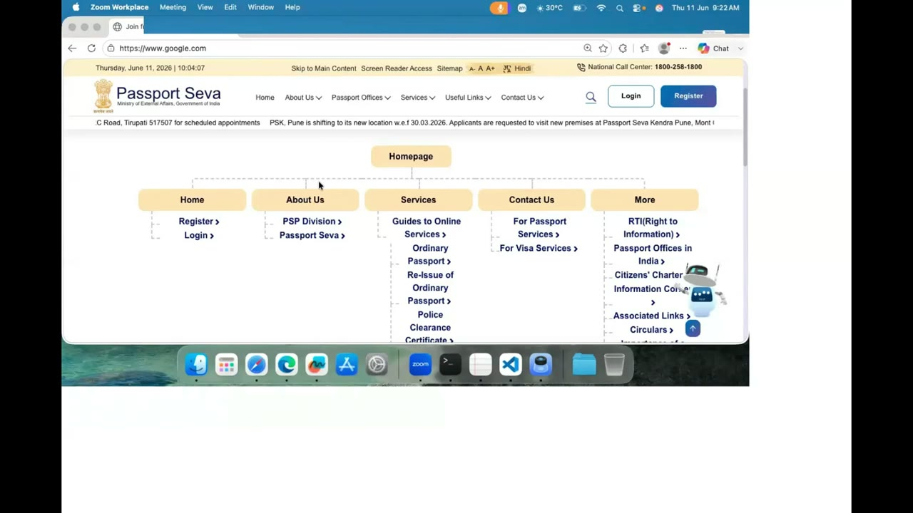

# 7️⃣ Phase 7 · Standards in the Wild: "I'm Feeling Lucky" & Sitemaps

**⏱️ 36:30 – 42:30** · 📂 S01 Course Intro & Web Fundamentals · [⬅️ Prev](06-Phase6-What-Is-Web.md) · [Next ➡️](08-Phase8-Layers-of-Web.md)

---

## ⏱️ 36:30 – 38:03 · 🧩 The Second Google Button ❓

🔑 **Key points**
- 🔎 Google's home page has **two buttons**. The second one is **"I'm Feeling Lucky"**.
- ❓ *"How many years have you used Google? And you don't know the second button on the first screen?"*
- 🎯 The point: you may think you know the internet well, but technical knowledge is different.

---

## ⏱️ 38:03 – 39:04 · 🧩 What "I'm Feeling Lucky" Does ⭐

🔑 **Key points**
- 🔎 Search **HTML** normally → a results page; the **first result is W3Schools**.
- 🍀 Type **HTML** and click **I'm Feeling Lucky** → Google **skips the results** and **opens the first result directly**.
```
  🔎 "HTML" + [ Google Search ]       ──► 📃 results page ──► you choose W3Schools
  🔎 "HTML" + [ I'm Feeling Lucky ]   ──► ⏩ no results page ──► 🌐 W3Schools opens directly
```
- 🎤 Instructor's warning: an interviewer may ask what the second button does. *"I don't know"* is not a good answer.

- 🎬 **Seen on screen (36:47 – 38:49):** the Google home page in a browser (India), with the buttons **Google Search** and **I'm Feeling Lucky**. He typed `html`; the normal results page showed **W3Schools "HTML Tutorial"** as the first result. Back on the home page he clicked **I'm Feeling Lucky** with `html` in the box, and the **W3Schools HTML Tutorial** page opened directly.

🧠 **Hook:** *Feeling Lucky = skip results, open result #1.*

---

## ⏱️ 39:04 – 40:01 · 🧩 Why Keep a Button Nobody Uses?

🔑 **Key points**
- 🤷 Google doesn't care whether you know about it or use it.
- 📏 Instructor's explanation: *"According to the standards, they have to keep it."*
- 🏛️ Whose standards? A community: **W3C**.

---

## ⏱️ 40:01 – 41:01 · 🧩 Passport Website: Too Many Options 🛂

🔑 **Key points**
- 🇮🇳 The **Government of India passport website** has many services and options.
- 😵 A new user is confused: *where is which option?*
- 🗺️ Per the standards (as taught): **every website should have a sitemap**: one place where the user sees **everything the site provides**.

---

## ⏱️ 41:01 – 42:01 · 🧩 Find the Sitemap 🗺️

🔑 **Key points**
- 🎬 **Seen on screen (39:11 – 41:41):** the **Passport Seva** site (Ministry of External Affairs, Government of India) with a top menu: Home, About Us, Passport Offices, Services, Useful Links, Contact Us, plus Login and Register; he opened several drop-down menus. In the thin strip above the menu, the links read: Skip to Main Content, Screen Reader Access, **Sitemap**, A- A A+, Hindi.
- 🎬 The Sitemap page is a tree chart. 📝 The address bar still showed the Google address while this site was displayed (recording artefact; the page itself is Passport Seva).
```
Homepage
├─ Home        : Register, Login
├─ About Us    : PSP Division, Passport Seva
├─ Services    : Guides to Online Services, Ordinary Passport,
│                Re-issue of Ordinary Passport, Police Clearance Certificate ...
├─ Contact Us  : For Passport Services, For Visa Services
└─ More        : RTI (Right to Information), Passport Offices in India,
                 Citizens' Charter, Information Corner, Associated Links,
                 Circulars ...
```

- 🔗 The passport site has a **small "Sitemap" link at the top**.
- 📋 Clicking it shows the **complete list** of where each topic is, so you reach any topic easily.
- ❓ Why keep it so small? Because the standards say it must be there.
- 🌍 Instructor: in the **US, UK, Germany** and other countries, a website that doesn't follow standards can be **banned / blocked** by the government; *"in our country, it's fine."*
```
  🛂 Passport site (many services)
      │
      └─ 🔗 [Sitemap] (small, top) ──► 📋 every section listed ──► 🎯 reach any topic fast
```
- 🎯 So you must **learn the standards**, not just the technology.

---

## ⏱️ 42:01 – 42:30 · 🧩 Recap

```
  🕸️ What is web?        portion of internet with restricted access
  👨‍🔬 Who developed it?   Tim Berners-Lee
  🏛️ Who maintains it?    W3C (World Wide Web Consortium)
```

---

## ✅ Quick Recall

```
  ☐ What does "I'm Feeling Lucky" do? Use the HTML → W3Schools example
  ☐ Why does Google keep it (as taught)?
  ☐ What is a sitemap, and where is it on the passport site?
  ☐ What can happen abroad to a site that ignores standards (as taught)?
```
