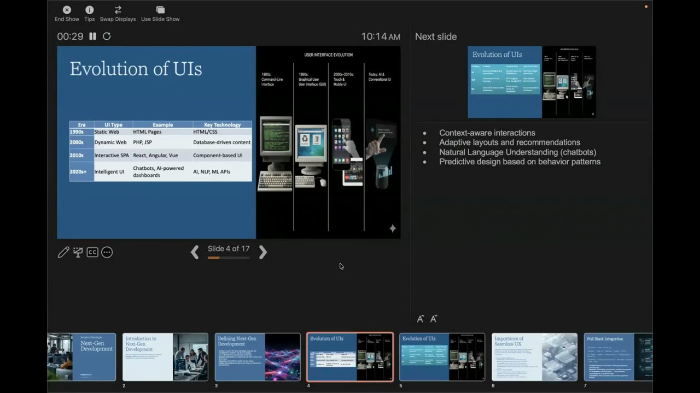

# 9️⃣ Phase 9 · Generations (Versions) of the Web

**⏱️ 50:50 – 56:00** · 📂 S01 Course Intro & Web Fundamentals · [⬅️ Prev](08-Phase8-Layers-of-Web.md) · [Next ➡️](10-Phase10-Web-Principles.md)

---

## ⏱️ 50:50 – 51:45 · 🧩 Which Generation Are We In? ⭐

🔑 **Key points**
- 🎤 Interview question for Java/.NET/Python devs too: *"Which generation of web are you currently in?"*
- 🔢 There are **four generations** of the web. **We are in the fourth.**
```
 1990s ─────────► 2000s ─────────► 2010s ─────────► 2020s ──► 📍 WE ARE HERE
 1️⃣ STATIC        2️⃣ DYNAMIC        3️⃣ SPA            4️⃣ AI WEB
```

🎬 **Seen on screen (51:19 – 52:27):** he opened a PowerPoint deck (*Presentation - Next-Gen Development*, slide 4 of 17, "Evolution of UIs") in slide-show view. Its table, copied from the slide:

```
 Era    UI Type          Example                     Key Technology
 1990s  Static Web       HTML Pages                  HTML/CSS
 2000s  Dynamic Web      PHP, JSP                    Database-driven content
 2010s  Interactive SPA  React, Angular, Vue         Component-based UI
 2020s+ Intelligent UI   Chatbots, AI-powered        AI, NLP, ML APIs
                         dashboards
```
Side text on the slide: 1980s Command-Line Interface · 1990s Graphical User Interface (GUI) · 2000s-2010s Touch & Mobile UI · Today: AI & Conversational UI.

🧠 **Hook:** *Static → Dynamic → SPA → AI. We're in Gen 4.*

---

## ⏱️ 51:45 – 52:37 · 🧩 1️⃣ Static Web (1990s)

🔑 **Key points**
- 🗓️ Started in **1990**, when **Tim Berners-Lee** introduced the web.
- 👀 **Static** = you can only **access and watch** what they provide. **No interaction**: you ask something, it doesn't respond to you.

---

## ⏱️ 52:37 – 52:54 · 🧩 2️⃣ Dynamic Web (2000)

🔑 **Key points**
- 🗓️ Started in **2000**.
- 💬 **Dynamic** = you can **interact**: ask what you want, and it **responds**.

---

## ⏱️ 52:54 – 54:00 · 🧩 3️⃣ Single-Page Applications, SPA (2010+)

🔑 **Key points**
- 🗓️ **2010 onwards**. Built with **Angular, AngularJS, React**.
- 📜 Examples: **Facebook, YouTube, Gmail, Instagram**.
- 🔄 Earlier you clicked **Next page / Previous page**. Now you **just scroll** and the rest of the content is **added at the bottom**. Everything comes on **one page**.
```
  EARLIER   [ Page 1 ] ──Next──► [ Page 2 ] ──Next──► [ Page 3 ]

  SPA       ┌──────────── one page ────────────┐
            │ post · post · post                │
            │ ⬇️ scroll ⬇️                       │
            │ + more content appended at bottom │
            └───────────────────────────────────┘
```
- 📌 *"Currently we are in SPA also."*

---

## ⏱️ 54:00 – 54:49 · 🧩 4️⃣ AI Web (2020+)

🔑 **Key points**
- 🤖 From **2020 onwards**, **artificial intelligence** came into the web.
- 🧠 This course will teach **intelligent UI**: how to **use AI in the web**, not only ordinary web apps.
- 🎯 We are building applications for the **fourth generation** of web.

---

## ⏱️ 54:49 – 56:00 · 🧩 Recap with Technologies ⭐

| # | 🗓️ Era | 🧩 Generation | 🛠️ Technologies named |
|---|---|---|---|
| 1️⃣ | 1990s | **Static web** | HTML, CSS |
| 2️⃣ | 2000s | **Dynamic web** | JSP, Java, PHP, ASP |
| 3️⃣ | 2010s | **SPA** | Angular, React, Vue |
| 4️⃣ | 2020s | **AI web** | Chatbots, AI agents |

- 🎬 **What he typed in his class notes** (55:33 onward, last state):
```
5. Web Versions
   1990's   static web    html, css
   2000's   dynamic web   jsp, php, asp
   2010's   SPA           angular, react, vue
   2020's   AI            chat bots etc.
```
- 🗣️ **Said, not typed:** "Java" in the 2000s list and "AI agents" in the 2020s list were spoken (55:29, 56:00) but the typed notes do not contain them.
- 🗣️ If asked *"What is the fourth generation?"*: **web in combination with AI** (artificial intelligence).

🧠 **Hook:** *HTML/CSS → JSP/PHP/ASP → Angular/React/Vue → Chatbots/Agents.*

---

## ✅ Quick Recall

```
  ☐ Which generation of web are we in?
  ☐ Year + one-line meaning for each of the 4 generations
  ☐ Technologies named for each generation
  ☐ Visible sign of an SPA (as taught): pagination vs scrolling
  ☐ What will this course add for Gen 4?
```
