# Session 01 · Key-frame timeline

- Offset: video = transcript +9s (speech agreement 93%)
- 93 key frames from 2493 samples every 2s

## before first phase

### f_00-00-06.jpg · video 00:00:06 · transcript 00:00:00

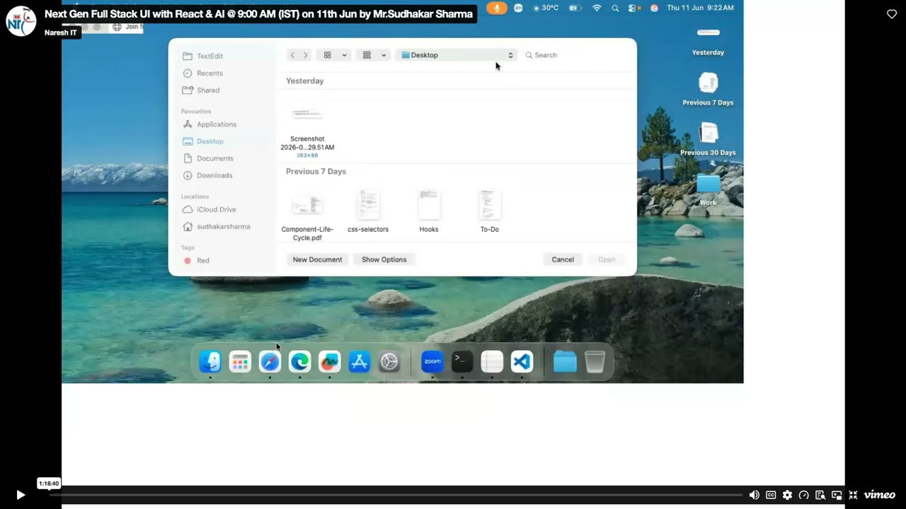

> (no speech nearby)

### f_00-00-16.jpg · video 00:00:16 · transcript 00:00:07

> (no speech nearby)

### f_00-00-30.jpg · video 00:00:30 · transcript 00:00:21

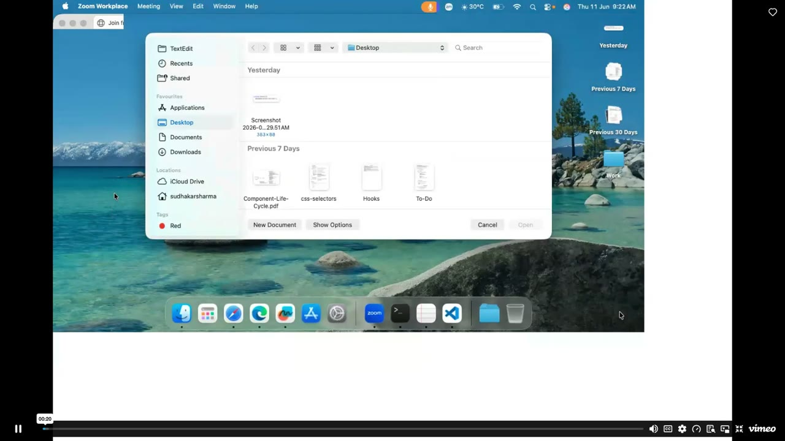

> (no speech nearby)

### f_00-01-08.jpg · video 00:01:08 · transcript 00:00:59

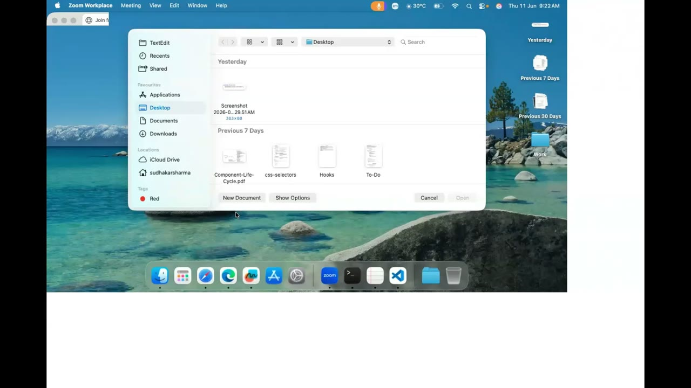

> (no speech nearby)

## 01-Phase1-Course-Structure.md

### f_00-02-02.jpg · video 00:02:02 · transcript 00:01:53

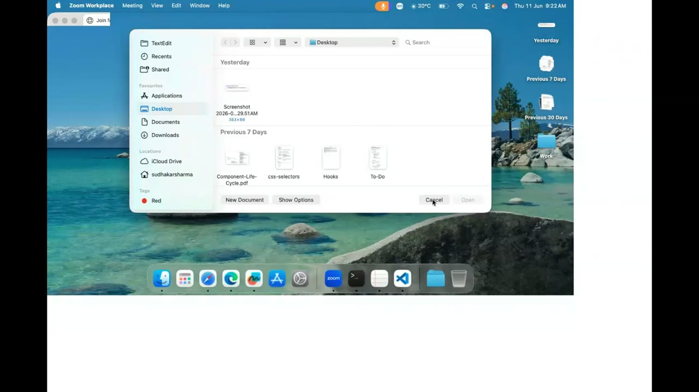

> Yeah. Good morning, everyone. So I will give a simple overview for our course concept. Actually, in this, you are going to learn-- In this batch, all different category people attend for front-end.

### f_00-02-08.jpg · video 00:02:08 · transcript 00:01:59

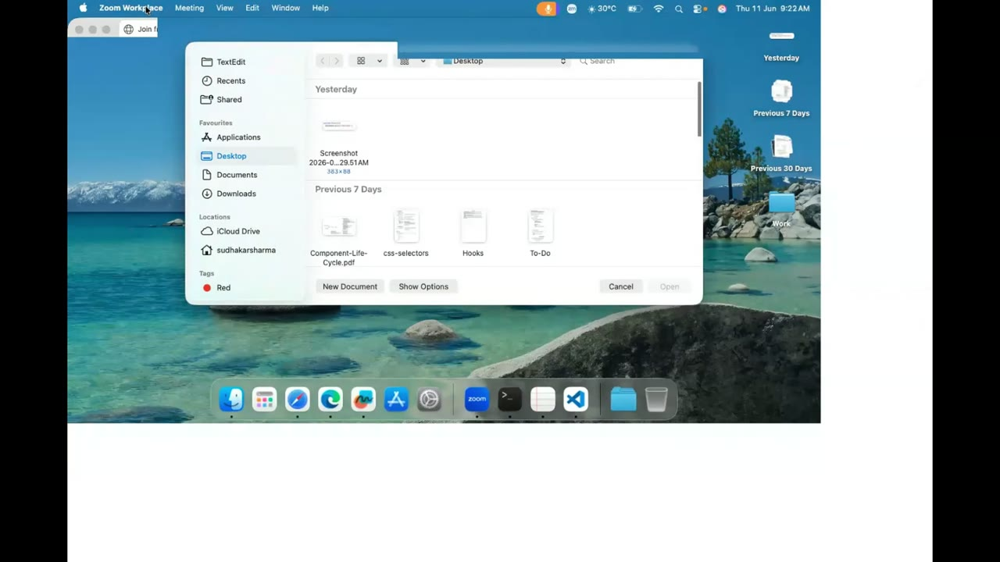

> Yeah. Good morning, everyone. So I will give a simple overview for our course concept. Actually, in this, you are going to learn-- In this batch, all different category people attend for front-end. So actually, we have

### f_00-02-14.jpg · video 00:02:14 · transcript 00:02:05

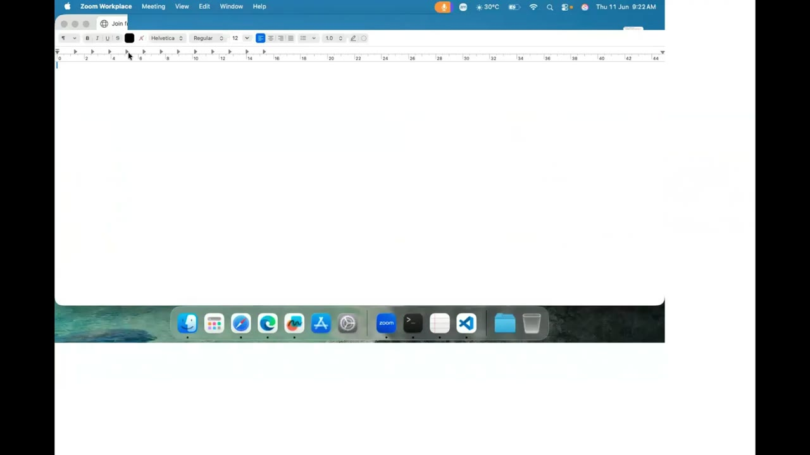

> Yeah. Good morning, everyone. So I will give a simple overview for our course concept. Actually, in this, you are going to learn-- In this batch, all different category people attend for front-end. So actually, we have UI full stack with the React.js.

### f_00-02-46.jpg · video 00:02:46 · transcript 00:02:37

> our course concept. Actually, in this, you are going to learn-- In this batch, all different category people attend for front-end. So actually, we have UI full stack with the React.js. This is actually the current course for you. But in this batch, people from Python, Java, .NET, different categories, different concepts, they attend this batch for UI. In this batch, UI full stack people also attend. We target this completely for all people who are learning front-end technologies

### f_00-06-46.jpg · video 00:06:46 · transcript 00:06:37

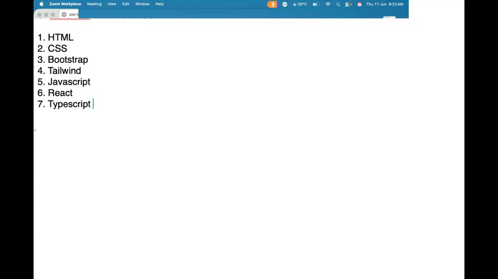

> In that we will post all the course content. So for different full stack people, whatever the course content is there, we will post. If anybody belongs to UI full stack, they can contact me related to full stack queries. UI full-stack queries. Java, Python, your Java, Python people will take care about that. Okay? So front-end is common for everyone. In back-end, it changes. Actually, in the back-end for UI full-stack people, we have MongoDB database, Express.js as middleware, and Node.js as server-side technology. For Java .NET people, they have their own frameworks, databases they will learn. Java, .NET, Python, all these people, they have their own frameworks. For UI full-stack people, it will be MongoDB, Express.js,

### f_00-07-16.jpg · video 00:07:16 · transcript 00:07:07

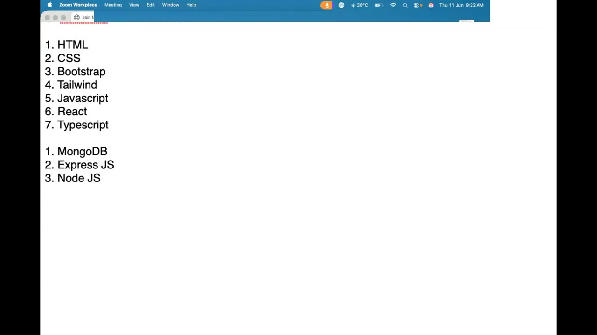

> for UI full-stack people, we have MongoDB database, Express.js as middleware, and Node.js as server-side technology. For Java .NET people, they have their own frameworks, databases they will learn. Java, .NET, Python, all these people, they have their own frameworks. For UI full-stack people, it will be MongoDB, Express.js, Node.js. These are in the back-end. But front-end will be same for everyone. Earlier, we used to have a separate front-end for general Python, Java people, but we are including you along with UI full-stack. Because generally, if you are Java, .NET, or Python developer, no need of complete ID on front-end. So we just give an overview and so we will

## 02-Phase2-Learning-Habits-Jobs.md

### f_00-10-16.jpg · video 00:10:16 · transcript 00:10:07

> I am coding here, you will be coding along with me. I hope you are clear. If you can do that, then you will have perfection on what you are learning. So instead of going home and later practicing, we will directly do that in the class. Not everything, few important concepts we will code along with you. Okay? Right. So we are going to start with the front-end concepts, right? For that, first you need to understand few topics. So first important you should know about various types of applications. Different types of application. Because you need to know what is HTML and all. Then for that, first you need to know different types of application. And when we are learning, so keep an habit of making a

### f_00-10-46.jpg · video 00:10:46 · transcript 00:10:37

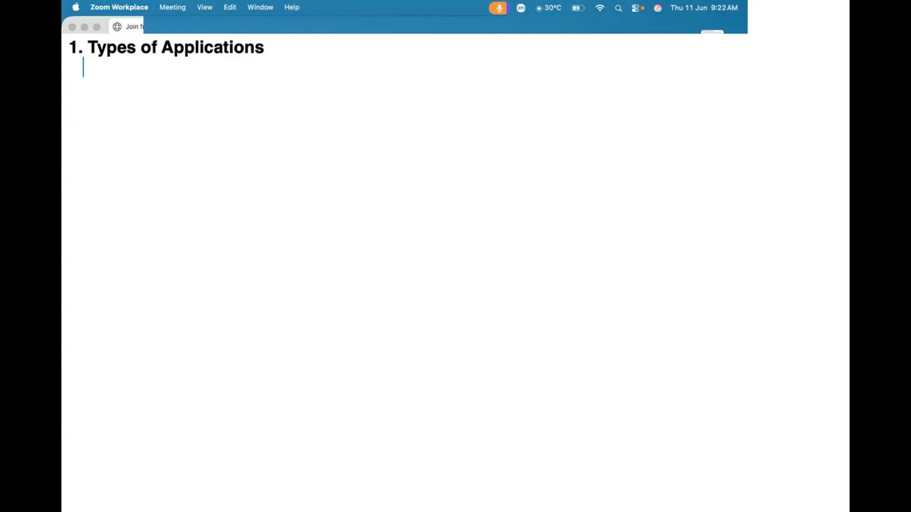

> For that, first you need to understand few topics. So first important you should know about various types of applications. Different types of application. Because you need to know what is HTML and all. Then for that, first you need to know different types of application. And when we are learning, so keep an habit of making a note of concepts. Right? That will help you in handling. Frankly speaking, I will tell you from past 25 years I am training. In Naresh IT, this is my 18th year. Right? And we have seen lacks of people. Unfortunately, from past few years, you can say from COVID onwards, we are unable to produce good software engineers,

### f_00-14-00.jpg · video 00:14:00 · transcript 00:13:51

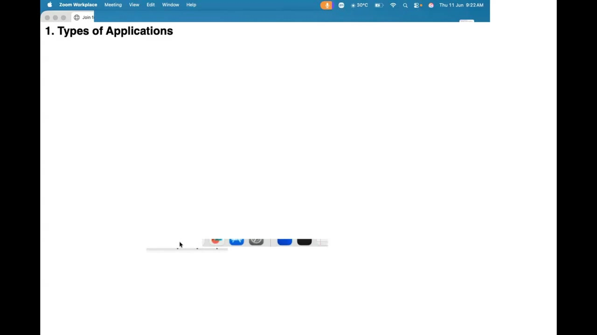

> They will not give you a laptop and ask that, "Write a program and show me." They will first give a paper and say that, "On paper, write the syntax of that concept and show me." And you must have a good practical knowledge on that. That means handwritten. So keep a habit of making note. You don't need to waste time in writing programs, but you have to have a habit of writing definitions, FAQs, whatever we discuss in class. Keep a habit of doing that. That is for your help. So it will be good for you. Because, see, we already saw so many. See, regularly, I will show you. This is my Instagram group. You can check. In this Instagram group, you can check. We regularly post some requirement. These are all the people who got placed in various

### f_00-14-04.jpg · video 00:14:04 · transcript 00:13:55

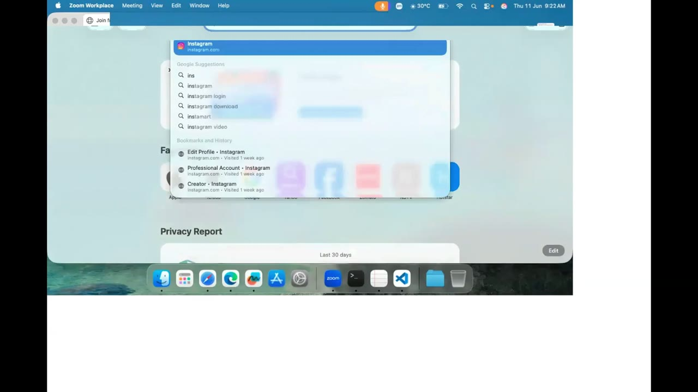

> me." They will first give a paper and say that, "On paper, write the syntax of that concept and show me." And you must have a good practical knowledge on that. That means handwritten. So keep a habit of making note. You don't need to waste time in writing programs, but you have to have a habit of writing definitions, FAQs, whatever we discuss in class. Keep a habit of doing that. That is for your help. So it will be good for you. Because, see, we already saw so many. See, regularly, I will show you. This is my Instagram group. You can check. In this Instagram group, you can check. We regularly post some requirement. These are all the people who got placed in various companies. And I will show you, these are all the

### f_00-14-30.jpg · video 00:14:30 · transcript 00:14:21

> That is for your help. So it will be good for you. Because, see, we already saw so many. See, regularly, I will show you. This is my Instagram group. You can check. In this Instagram group, you can check. We regularly post some requirement. These are all the people who got placed in various companies. And I will show you, these are all the requirements. This is very recent requirement as React developer. Many people ask like jobs. Remember, these are the companies. Here I posted so many. And these are the companies. These are the companies which you will not find in Naukri. These are all Naresh IT clients. Here already, your senior students who learned, they are

### f_00-15-06.jpg · video 00:15:06 · transcript 00:14:57

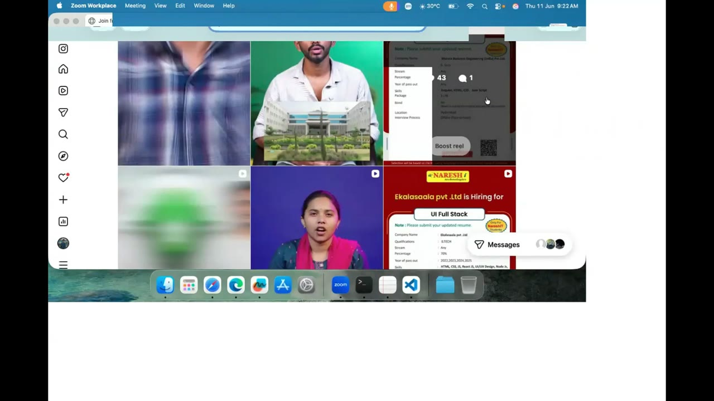

> This is very recent requirement as React developer. Many people ask like jobs. Remember, these are the companies. Here I posted so many. And these are the companies. These are the companies which you will not find in Naukri. These are all Naresh IT clients. Here already, your senior students who learned, they are working. Generally, they send message to us saying that, "Sir, in our company, we need these people." So they don't want to go to Naukri for searching people. They just come here because they have a confidence that here some good people are made. And these jobs you will not find outside. And when we post this, you see what is the qualification they say. They say that any stream, any year passed out. If you have good skill, here I usually post related to front-end. Actually, in our Naresh IT Instagram, you will get

### f_00-15-38.jpg · video 00:15:38 · transcript 00:15:29

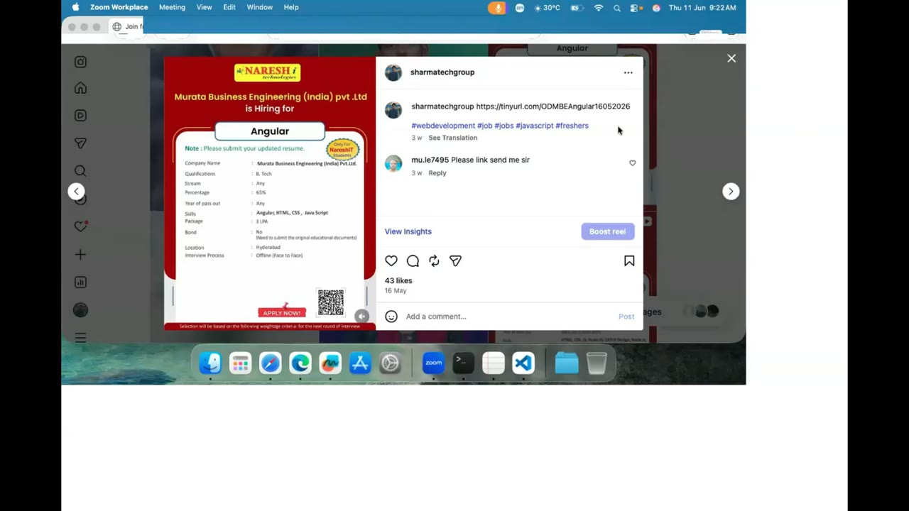

> They just come here because they have a confidence that here some good people are made. And these jobs you will not find outside. And when we post this, you see what is the qualification they say. They say that any stream, any year passed out. If you have good skill, here I usually post related to front-end. Actually, in our Naresh IT Instagram, you will get all technology. Here I will post only front-end related opportunities. And if you are good at JavaScript, HTML, CSS, Bootstrap, there are so many opportunities for you. Especially with just React and JavaScript, you can get lot of opportunities in spite of having a career gap or percentage of marks, or a technical background, doesn't matter.

### f_00-16-38.jpg · video 00:16:38 · transcript 00:16:29

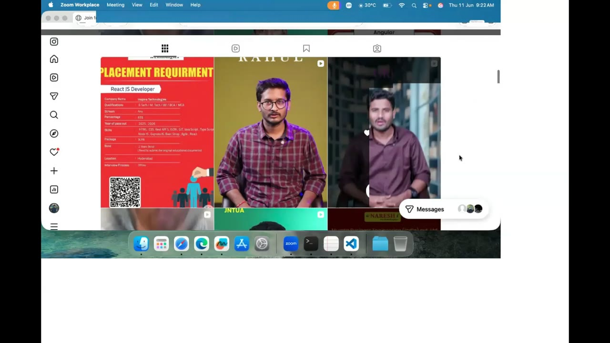

> So actually, you see these are all the people, and these days they don't even see communication skills and all. Not required. If you are good at skills in technology, enough. Many of our people can't speak proper English. They cannot communicate well, but they are very good in technology. They get placed. And you see these people recently placed, and they are still doing course with us. They haven't completed the course. And they are placed on JavaScript and React-like technologies. So if you are good at front-end, you need not to wait up till you finish the complete full stack. You can get placed into companies with good knowledge in front-end. So these are all front-end jobs. Whatever I post here, they are all front-end jobs majority. You can see here they ask just any percentage of marks, any year passed out, any qualification.

### f_00-16-42.jpg · video 00:16:42 · transcript 00:16:33

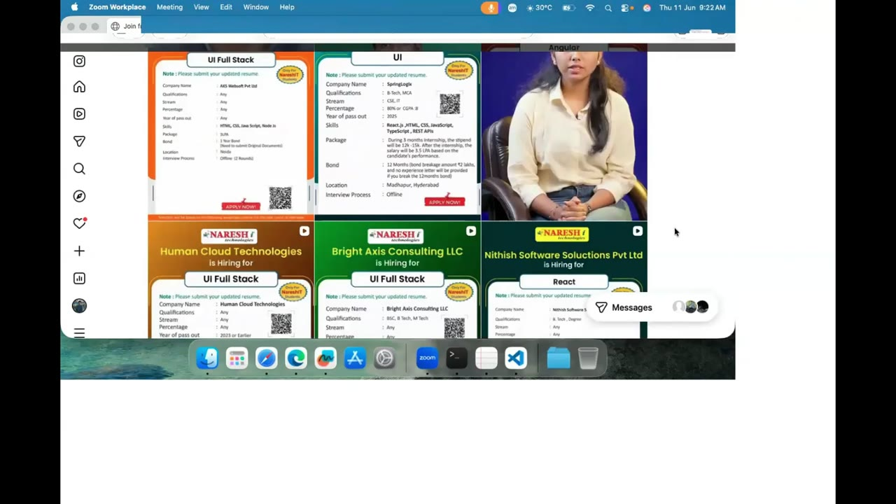

> and these days they don't even see communication skills and all. Not required. If you are good at skills in technology, enough. Many of our people can't speak proper English. They cannot communicate well, but they are very good in technology. They get placed. And you see these people recently placed, and they are still doing course with us. They haven't completed the course. And they are placed on JavaScript and React-like technologies. So if you are good at front-end, you need not to wait up till you finish the complete full stack. You can get placed into companies with good knowledge in front-end. So these are all front-end jobs. Whatever I post here, they are all front-end jobs majority. You can see here they ask just any percentage of marks, any year passed out, any qualification. Any qualification. So they are ready to take you, but only the point, you need skills.

### f_00-17-14.jpg · video 00:17:14 · transcript 00:17:05

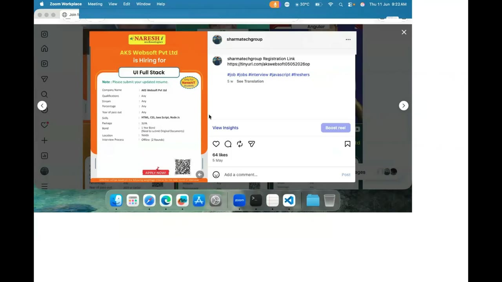

> the complete full stack. You can get placed into companies with good knowledge in front-end. So these are all front-end jobs. Whatever I post here, they are all front-end jobs majority. You can see here they ask just any percentage of marks, any year passed out, any qualification. Any qualification. So they are ready to take you, but only the point, you need skills. And here, majority HTML, CSS, JavaScript. If you are perfect in that, enough. And for these skills, 3 lakh per annum package is too much. That's a fresher package for that. So if you perfectly practice, and whatever we discuss in class, if you are perfect in that practically, then you are ready for job. We will learn the technology in very depth so that you can crack interviews at

## 03-Phase3-Types-of-Applications.md

### f_00-17-32.jpg · video 00:17:32 · transcript 00:17:23

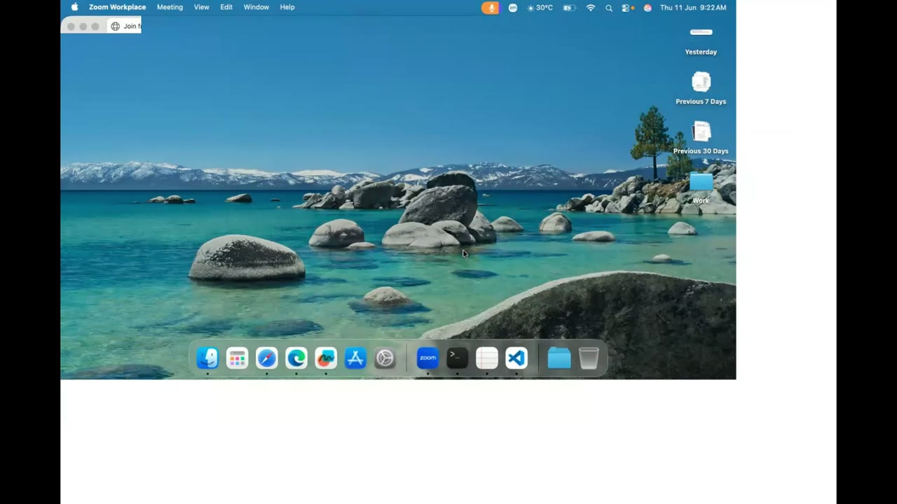

> any year passed out, any qualification. Any qualification. So they are ready to take you, but only the point, you need skills. And here, majority HTML, CSS, JavaScript. If you are perfect in that, enough. And for these skills, 3 lakh per annum package is too much. That's a fresher package for that. So if you perfectly practice, and whatever we discuss in class, if you are perfect in that practically, then you are ready for job. We will learn the technology in very depth so that you can crack interviews at any level of experience. Okay? So we will start everything step by step. First, why to learn HTML, CSS, and all? To understand that concept, first you should know what are different types of applications we have. I hope you people already know.

### f_00-18-04.jpg · video 00:18:04 · transcript 00:17:55

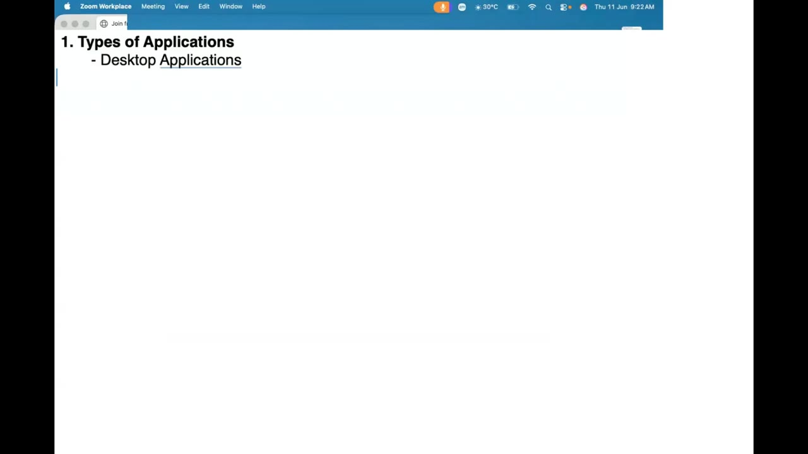

> you are ready for job. We will learn the technology in very depth so that you can crack interviews at any level of experience. Okay? So we will start everything step by step. First, why to learn HTML, CSS, and all? To understand that concept, first you should know what are different types of applications we have. I hope you people already know. Can you tell how many types of application, software applications we are having? Actually, we have desktop applications. Desktop applications. We have web applications. We have distributed applications. Distributed applications. We have mobile applications. Mobile applications. We have IoT applications.

### f_00-18-34.jpg · video 00:18:34 · transcript 00:18:25

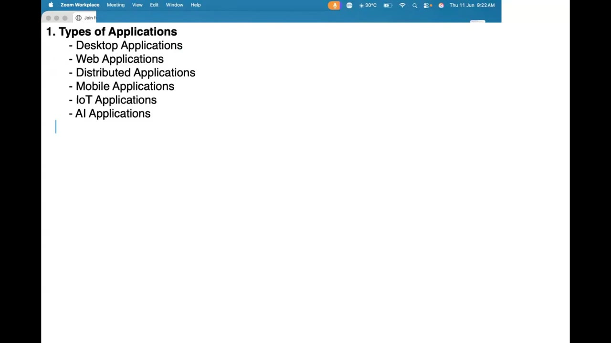

> are having? Actually, we have desktop applications. Desktop applications. We have web applications. We have distributed applications. Distributed applications. We have mobile applications. Mobile applications. We have IoT applications. IoT, Internet of Things. IoT applications, and we have AI applications. And we have 2D, 3D applications, 2D and 3D gaming applications. These are all different type of applications. That means, as a software developer, your career can be into any of these. That means, for example, you are learning some Java

### f_00-19-04.jpg · video 00:19:04 · transcript 00:18:55

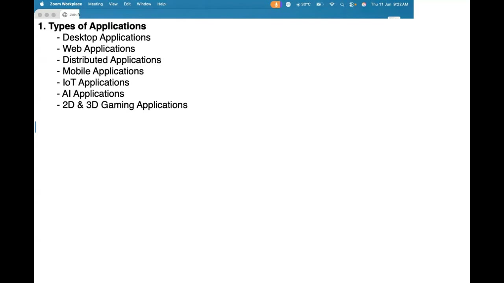

> IoT, Internet of Things. IoT applications, and we have AI applications. And we have 2D, 3D applications, 2D and 3D gaming applications. These are all different type of applications. That means, as a software developer, your career can be into any of these. That means, for example, you are learning some Java or Python or .NET. Can you tell me what type of applications you are learning to build? You are Java developers? Any Java developers are there? So what type of applications you will build with Java? You can build desktop apps, you can build web

## 04-Phase4-Course-Target.md

### f_00-24-04.jpg · video 00:24:04 · transcript 00:23:55

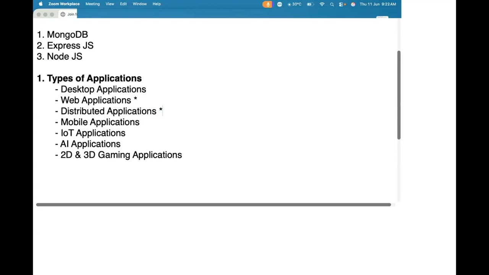

> by learning the front-end concepts, whatever I showed you in our class, that means by learning these concepts. See, by learning all these concepts, we can build two types of applications: web and distributed. This is our target. That means by learning this course as a full-stack developer, you can build two types of apps. What are those? Web applications, another one, distributed. So we are not teaching you any desktop applications because that is not the current generation. Current generation is all about web applications and other one, distributed. So we are going to build two types of apps. One is web and distributed with the knowledge of full-stack. And remember, the UI that you learn here, it is

### f_00-27-04.jpg · video 00:27:04 · transcript 00:26:55

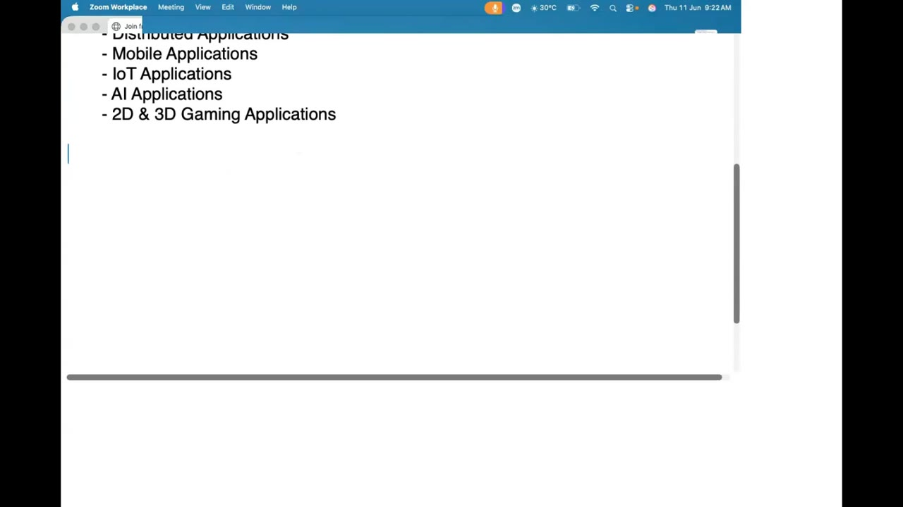

> information, they will come from online. They need to be connected. So you are going to learn these two applications, web application, another one, distribute. For those applications, I am going to teach only front-end, not back-end. This class is about only front-end. Back-end, according to your course, you will have separate back-end batches. So in this course, we are going to learn how to build front-end for web applications as well as distribute. Am I clear? Right. So now let's see. So you are going to learn how to build web applications. So we should have idea about web applications. So you need to understand web applications. That means our target is now to build these web applications. So for this, few more basics you need to know.

## 05-Phase5-Why-Depth-Network-Basics.md

### f_00-27-34.jpg · video 00:27:34 · transcript 00:27:25

> Am I clear? Right. So now let's see. So you are going to learn how to build web applications. So we should have idea about web applications. So you need to understand web applications. That means our target is now to build these web applications. So for this, few more basics you need to know. First, you need to understand what is web. So you need to understand what is web. Because you are a web developer, you should know so many things. Remember, all these days, generally what you know, and in general what you know, technically what they are little different. Right? I will show you one concept, means why you should be technically perfect, I will tell you.

### f_00-27-58.jpg · video 00:27:58 · transcript 00:27:49

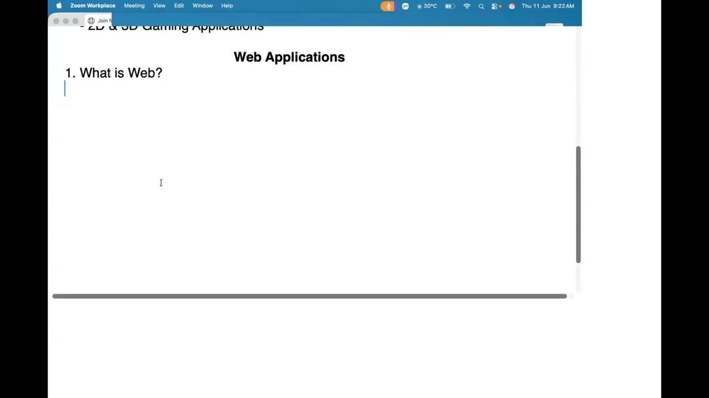

> So for this, few more basics you need to know. First, you need to understand what is web. So you need to understand what is web. Because you are a web developer, you should know so many things. Remember, all these days, generally what you know, and in general what you know, technically what they are little different. Right? I will show you one concept, means why you should be technically perfect, I will tell you. Recently, just yesterday, I got one requirement. I will show you that requirement. That means recently I got a requirement from KEVI, Kendriya Vidyalaya. Kendriya Vidyalaya is central governments. Right? So CBSE schools. For armed

### f_00-28-30.jpg · video 00:28:30 · transcript 00:28:21

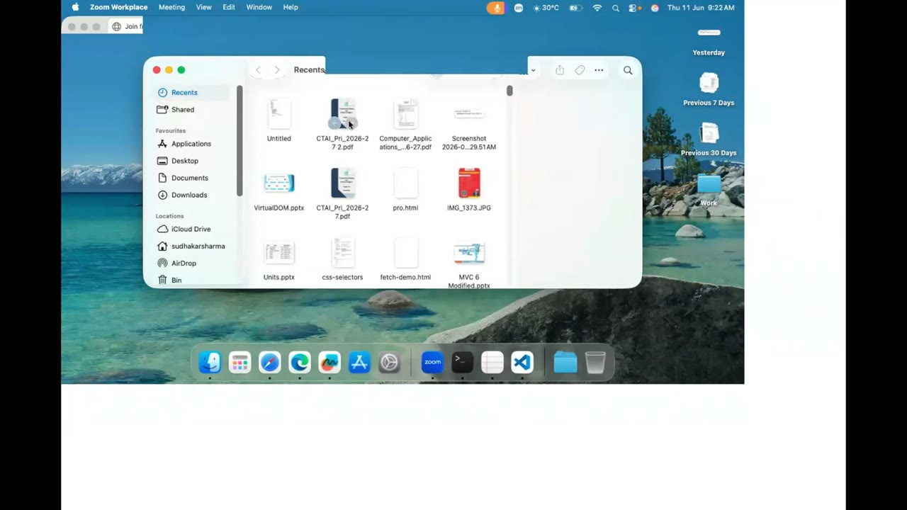

> perfect, I will tell you. Recently, just yesterday, I got one requirement. I will show you that requirement. That means recently I got a requirement from KEVI, Kendriya Vidyalaya. Kendriya Vidyalaya is central governments. Right? So CBSE schools. For armed forces, air force, and all these people, KEVI, Kendriya Vidyalaya is there. And they sent me one content. Indian government has launched a new course content for CBSE people. I will show you. And this is the course content. This is the content they have sent me. And this is Computational and Thinking with Artificial Intelligence from class three onwards.

### f_00-29-08.jpg · video 00:29:08 · transcript 00:28:59

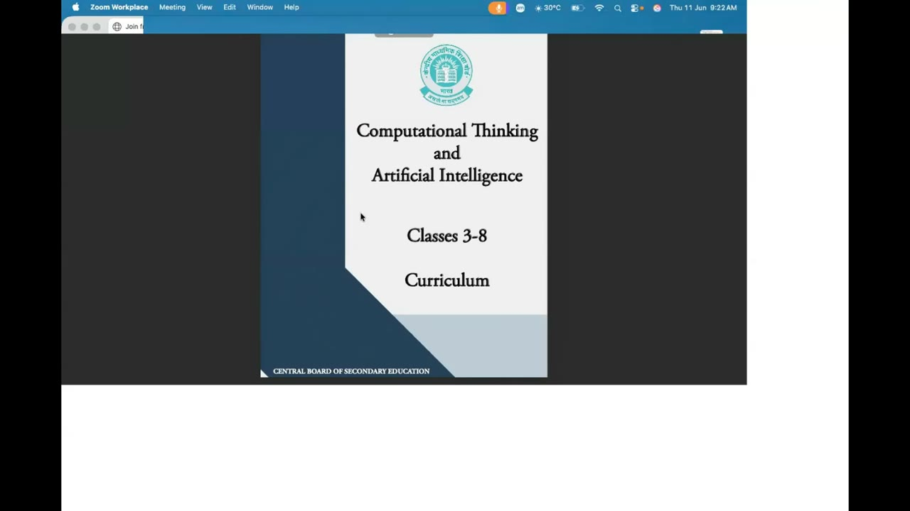

> for CBSE people. I will show you. And this is the course content. This is the content they have sent me. And this is Computational and Thinking with Artificial Intelligence from class three onwards. This is the new curriculum of central CBSE. It is new curriculum of CBSE. That means from third class onwards, they are going to start AI. And do you know, in 10th class, they introduced Python with data science for CBSE. That means you cannot have skills like previous. You need to be very potential. That means you need to be very competitive because the school kids will take over you.

### f_00-30-10.jpg · video 00:30:10 · transcript 00:30:01

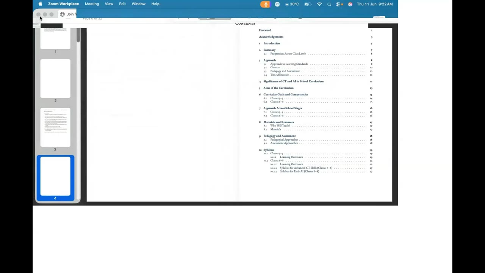

> Right? You do this after your post-graduation or graduation. In graduation, you are doing this. They are doing now from third grade. By eighth grade, they are going to finish AI with Python. That means in eighth and ninth, they started Python, and in 10th they have the concept of data science, data analytics. Now you can imagine how competitive it will be. Right? And you need to have a strong knowledge. And this is all their course content. They shared this content. Why they shared with us? Because nothing but they want our Naresh IT to teach their faculties these concepts so that they can train them to the students. Because it is one year academic. One year, every week, three days, one period will be on

### f_00-30-42.jpg · video 00:30:42 · transcript 00:30:33

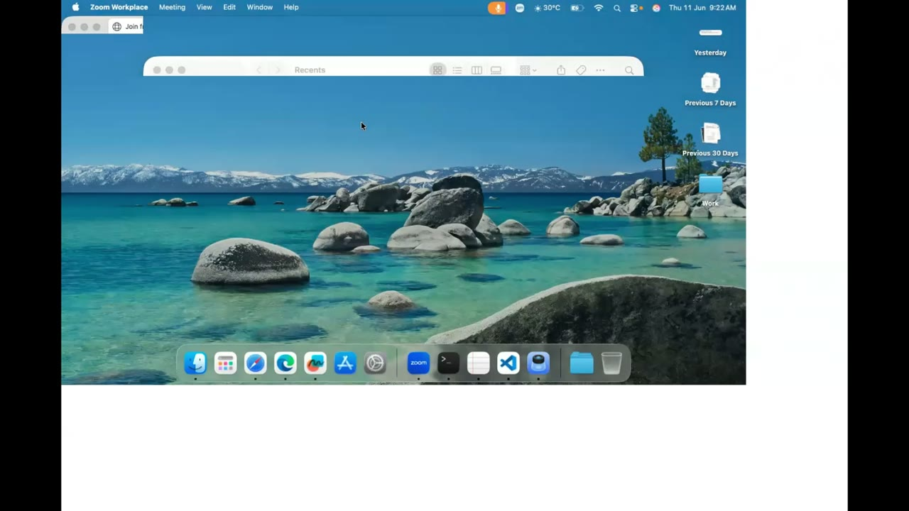

> Right? And you need to have a strong knowledge. And this is all their course content. They shared this content. Why they shared with us? Because nothing but they want our Naresh IT to teach their faculties these concepts so that they can train them to the students. Because it is one year academic. One year, every week, three days, one period will be on AI for these school people. We can't go and train them. So what is their concept is they will send trainers to here, their faculty, they send here. We will train them on those concepts, and they are ready for training students. So this curriculum, if you see that, I hope you understood. That means you need to be very strong in every concept. Because so much depth about the concept are asked in interviews, you should be very strong in that. So you are a web developer, so you need to have

### f_00-31-34.jpg · video 00:31:34 · transcript 00:31:25

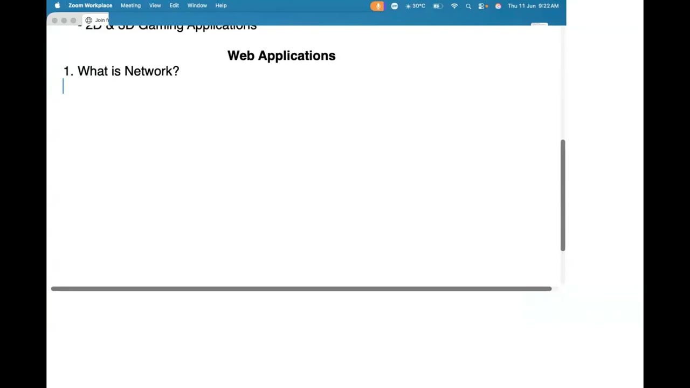

> Because so much depth about the concept are asked in interviews, you should be very strong in that. So you are a web developer, so you need to have a perfect knowledge on web. Let's see. We will see from basic to advance everything. First point, in order to understand what is web, first, I hope you people know what is network. This everybody knows? No need to explain. Tell me what is a computer network. How you define a computer network? A computer network is nothing but group of computers connected with each other for sharing information and resources. Am I right? We can share information, and we can share resources. A group of computers connected with each other for sharing information and resources. This is a basic thing.

### f_00-32-04.jpg · video 00:32:04 · transcript 00:31:55

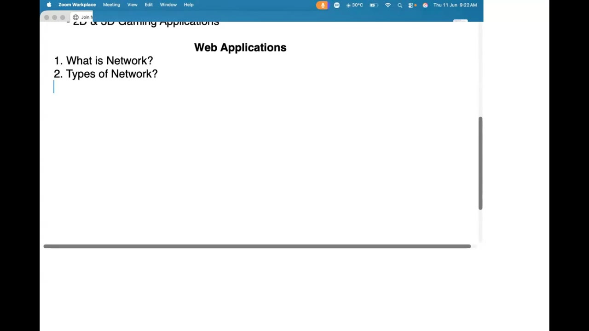

> How you define a computer network? A computer network is nothing but group of computers connected with each other for sharing information and resources. Am I right? We can share information, and we can share resources. A group of computers connected with each other for sharing information and resources. This is a basic thing. Actually, do you know types of networks? I hope this also you know. Different types of networks. LAN, MAN, WAN, range, capacity, different types of networks. These are all general basics, so I will not go much about them. Later we will go into other concept. Another important, you know already what is network and what are the different types of networks.

## 06-Phase6-What-Is-Web.md

### f_00-32-34.jpg · video 00:32:34 · transcript 00:32:25

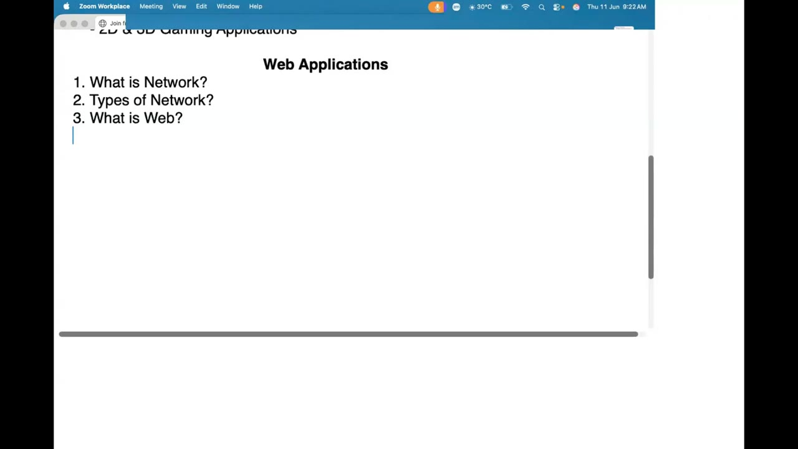

> Actually, do you know types of networks? I hope this also you know. Different types of networks. LAN, MAN, WAN, range, capacity, different types of networks. These are all general basics, so I will not go much about them. Later we will go into other concept. Another important, you know already what is network and what are the different types of networks. Now the key point is you need to understand what is web. What is the concept of web? How you define web as a developer? The point is very simple. Actually, web is a portion of internet with restricted access. This is the definition of web. How you define web.

### f_00-33-04.jpg · video 00:33:04 · transcript 00:32:55

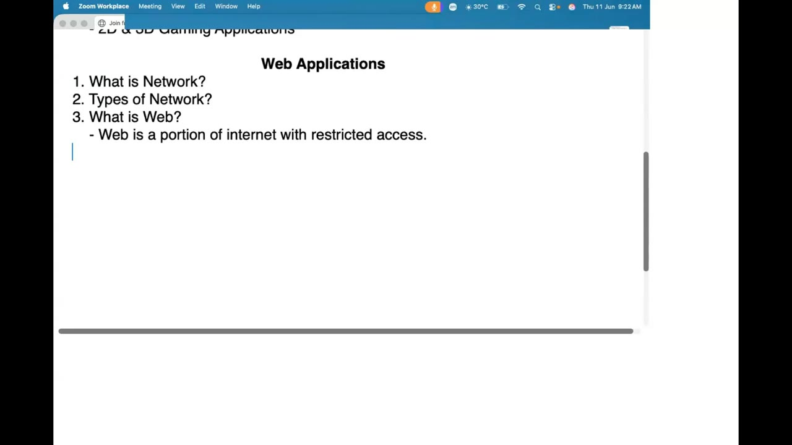

> Now the key point is you need to understand what is web. What is the concept of web? How you define web as a developer? The point is very simple. Actually, web is a portion of internet with restricted access. This is the definition of web. How you define web. Web is a portion of internet with restricted access. I will tell you the nature of web. Means it is part of internet, but restricted in access. That means simple, I will tell you, for example, you have Netflix. How much I need subscription money for Netflix to watch movies on Netflix? How much money I need?

### f_00-34-04.jpg · video 00:34:04 · transcript 00:33:55

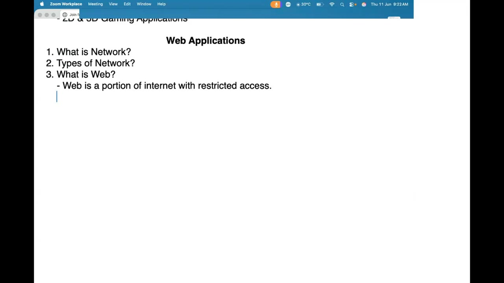

> For example, do you know per month you can pay 199 rupees, and they will give you Netflix for only one device. You know? You pay more money, 400 rupees, they will give you on four devices. Am I right? You know this now? And you pay more money, some 600, 800 rupees per month, they will give you 4K quality videos, movies. Am I right? You know this? That means what is this? That means I am restricted with even quality of video. Understood? You are restricted with some resources. You are not allowed to access on multiple device. You are not allowed to access more content. You are allowed to access only limited quality. This is the nature of web.

### f_00-36-04.jpg · video 00:36:04 · transcript 00:35:55

> It will have some information. Can everybody watch? No, I will control. I will decide who can watch, I will decide how much he can watch, and I will decide what he can watch. This is restricted in nature. This type of concept was actually introduced by Tim Berners-Lee. Tim Berners-Lee, he introduced the concept of web. We call him father of web. Web concept was designed and developed by a person, Tim Berners-Lee, and he's the person who invented HTML. HTML designed by Tim Berners-Lee. We call him father of web. And currently, who maintains web you know? Currently, who maintains web you know? Don't know? W3C.

### f_00-36-34.jpg · video 00:36:34 · transcript 00:36:25

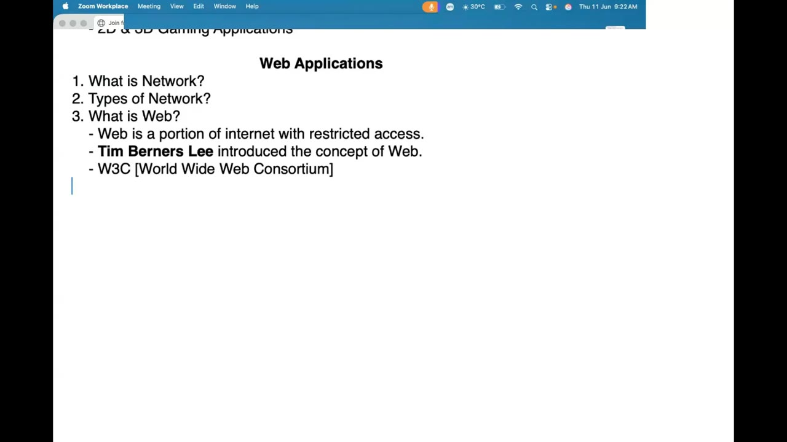

> the concept of web. We call him father of web. Web concept was designed and developed by a person, Tim Berners-Lee, and he's the person who invented HTML. HTML designed by Tim Berners-Lee. We call him father of web. And currently, who maintains web you know? Currently, who maintains web you know? Don't know? W3C. W3C is World Wide Web Consortium. Consortium. These people maintains the web standards. That means if you are building a website, you have to follow the rules of W3C. Remember, in real time, you cannot build a website just what you know about it. You have to build as per rules. I will tell you how much web concept you know. Means, you think that you know internet very well.

## 07-Phase7-Standards-In-The-Wild.md

### f_00-36-56.jpg · video 00:36:56 · transcript 00:36:47

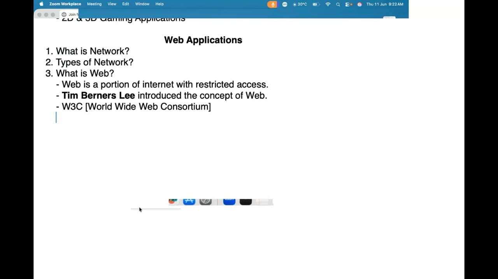

> Currently, who maintains web you know? Don't know? W3C. W3C is World Wide Web Consortium. Consortium. These people maintains the web standards. That means if you are building a website, you have to follow the rules of W3C. Remember, in real time, you cannot build a website just what you know about it. You have to build as per rules. I will tell you how much web concept you know. Means, you think that you know internet very well. Right? But I will tell you how much you know about internet. See, this is Google. Now, can you tell me what is the purpose of this second button in Google? I am feeling lucky. What is the purpose of that second button in Google?

### f_00-37-30.jpg · video 00:37:30 · transcript 00:37:21

> I will tell you how much web concept you know. Means, you think that you know internet very well. Right? But I will tell you how much you know about internet. See, this is Google. Now, can you tell me what is the purpose of this second button in Google? I am feeling lucky. What is the purpose of that second button in Google? From how many years you are using Google? From how many years you are using Google? After all, first screen, second button, you don't know. Now imagine your knowledge on technology. Understood? You think that I know everything, but by this point itself, tells that how much you know about internet. Do you know what it is, second button?

### f_00-38-00.jpg · video 00:38:00 · transcript 00:37:51

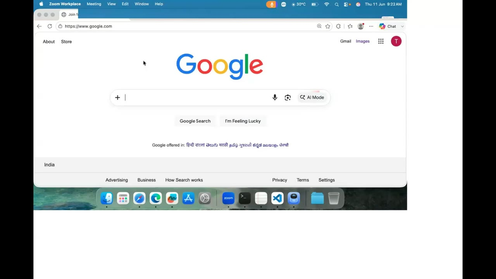

> From how many years you are using Google? From how many years you are using Google? After all, first screen, second button, you don't know. Now imagine your knowledge on technology. Understood? You think that I know everything, but by this point itself, tells that how much you know about internet. Do you know what it is, second button? Don't know? Now imagine how many years you are using Google, after all, second button in first screen, you don't know. That is the quality of developers. Understood? And you can't be like this. You need to know technically everything. Do you know what is the purpose of second button? Second button is nothing but, suppose I am searching.

### f_00-38-22.jpg · video 00:38:22 · transcript 00:38:13

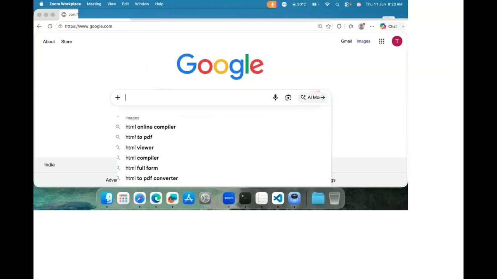

> itself, tells that how much you know about internet. Do you know what it is, second button? Don't know? Now imagine how many years you are using Google, after all, second button in first screen, you don't know. That is the quality of developers. Understood? And you can't be like this. You need to know technically everything. Do you know what is the purpose of second button? Second button is nothing but, suppose I am searching. When I am searching for a topic HTML, then it will get me some results. In that, what is the first result? It is W3Schools. Am I right? Now what happens is, when I type HTML, and when I click, I am feeling lucky, I am telling Google that don't show me any results, take me to the first result.

### f_00-38-30.jpg · video 00:38:30 · transcript 00:38:21

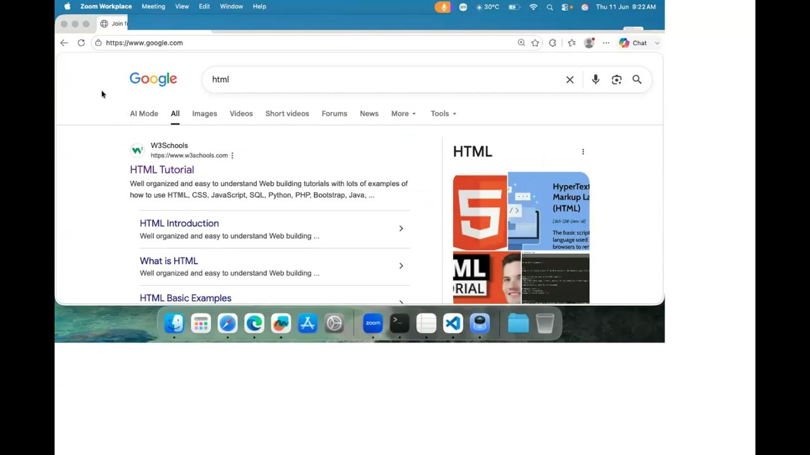

> Don't know? Now imagine how many years you are using Google, after all, second button in first screen, you don't know. That is the quality of developers. Understood? And you can't be like this. You need to know technically everything. Do you know what is the purpose of second button? Second button is nothing but, suppose I am searching. When I am searching for a topic HTML, then it will get me some results. In that, what is the first result? It is W3Schools. Am I right? Now what happens is, when I type HTML, and when I click, I am feeling lucky, I am telling Google that don't show me any results, take me to the first result. Understood? I am telling that don't show me any result, take me to the first result directly.

### f_00-38-50.jpg · video 00:38:50 · transcript 00:38:41

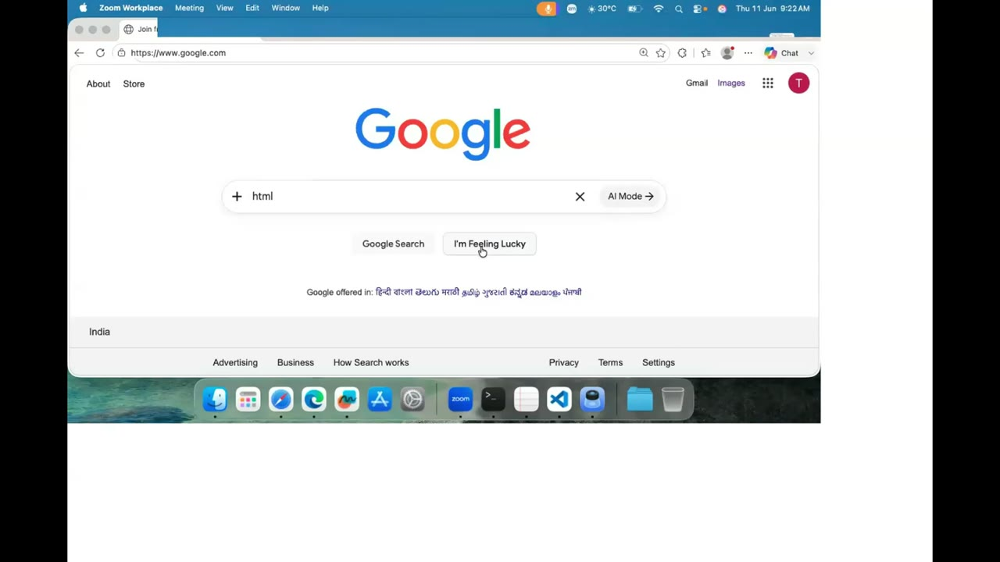

> You need to know technically everything. Do you know what is the purpose of second button? Second button is nothing but, suppose I am searching. When I am searching for a topic HTML, then it will get me some results. In that, what is the first result? It is W3Schools. Am I right? Now what happens is, when I type HTML, and when I click, I am feeling lucky, I am telling Google that don't show me any results, take me to the first result. Understood? I am telling that don't show me any result, take me to the first result directly. Then when I click, I am feeling lucky, it will directly open W3Schools. Now imagine how much you know about internet. And if you go and call, "I am a Java developer" in interview, he will ask, tell me the second button, what it does.

### f_00-38-54.jpg · video 00:38:54 · transcript 00:38:45

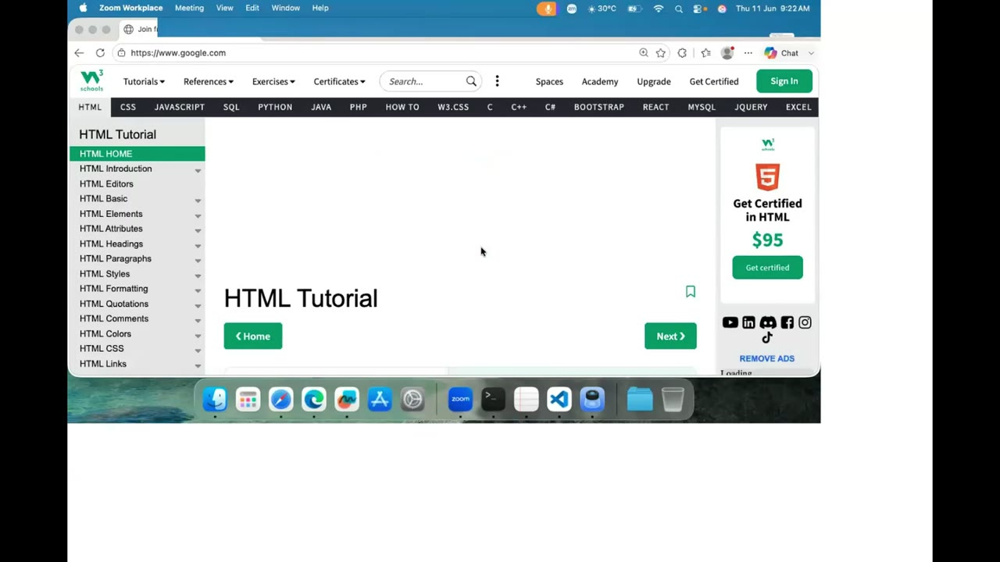

> Do you know what is the purpose of second button? Second button is nothing but, suppose I am searching. When I am searching for a topic HTML, then it will get me some results. In that, what is the first result? It is W3Schools. Am I right? Now what happens is, when I type HTML, and when I click, I am feeling lucky, I am telling Google that don't show me any results, take me to the first result. Understood? I am telling that don't show me any result, take me to the first result directly. Then when I click, I am feeling lucky, it will directly open W3Schools. Now imagine how much you know about internet. And if you go and call, "I am a Java developer" in interview, he will ask, tell me the second button, what it does. And you say that, "I don't know." Seriously?

### f_00-38-58.jpg · video 00:38:58 · transcript 00:38:49

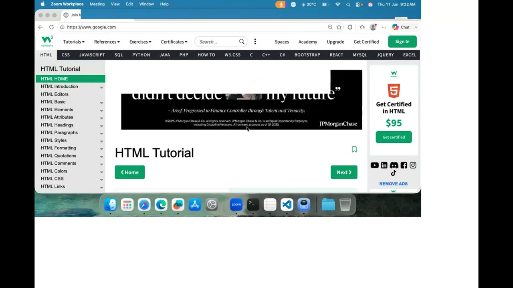

> Second button is nothing but, suppose I am searching. When I am searching for a topic HTML, then it will get me some results. In that, what is the first result? It is W3Schools. Am I right? Now what happens is, when I type HTML, and when I click, I am feeling lucky, I am telling Google that don't show me any results, take me to the first result. Understood? I am telling that don't show me any result, take me to the first result directly. Then when I click, I am feeling lucky, it will directly open W3Schools. Now imagine how much you know about internet. And if you go and call, "I am a Java developer" in interview, he will ask, tell me the second button, what it does. And you say that, "I don't know." Seriously?

### f_00-39-20.jpg · video 00:39:20 · transcript 00:39:11

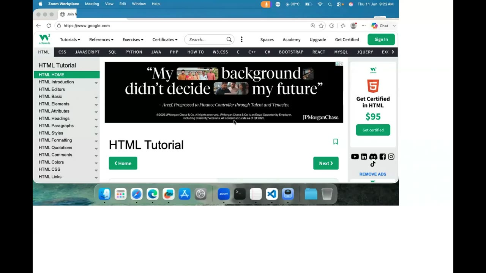

> Google that don't show me any results, take me to the first result. Understood? I am telling that don't show me any result, take me to the first result directly. Then when I click, I am feeling lucky, it will directly open W3Schools. Now imagine how much you know about internet. And if you go and call, "I am a Java developer" in interview, he will ask, tell me the second button, what it does. And you say that, "I don't know." Seriously? This is what you need to know. That means web learning way is different, in real world different. You may be thinking like, if so many people don't know how to use it, why they kept it? Am I right? You never use this now all these days. Then why they kept it? They should have educated you at least.

### f_00-40-28.jpg · video 00:40:28 · transcript 00:40:19

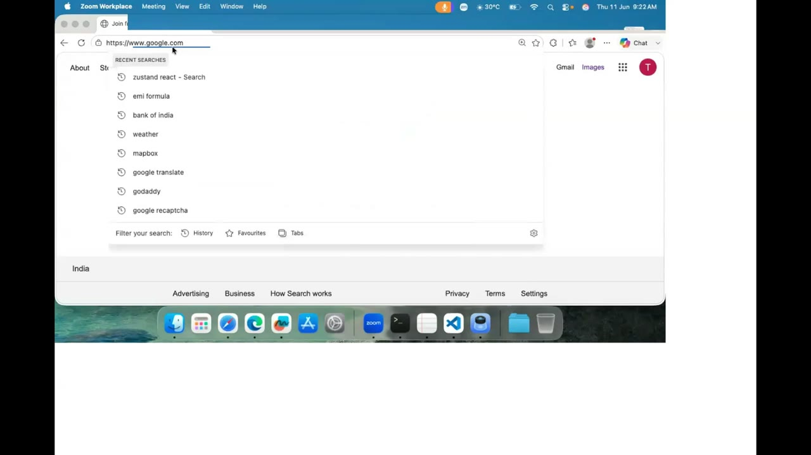

> They don't care whether you will use or not. They don't care whether you know or not. Then why they kept it? Because according to standards, they have to keep it. Understood? According to the standards, they have to keep it. That means they don't care whether you know or you will use. According to standards, they have to keep. That's the reason they kept it. And whose standards? Who tells all these standards? These are all maintained by a community. Which community that is? W3C, World Wide Web Consortium. Those people maintains the standards of web. I will show you so many such things. For example, we have passport server. This is government of India passport website. Observe government of India passport website. Now in this, they have lot of options. So many services are present. There are so many services

### f_00-40-44.jpg · video 00:40:44 · transcript 00:40:35

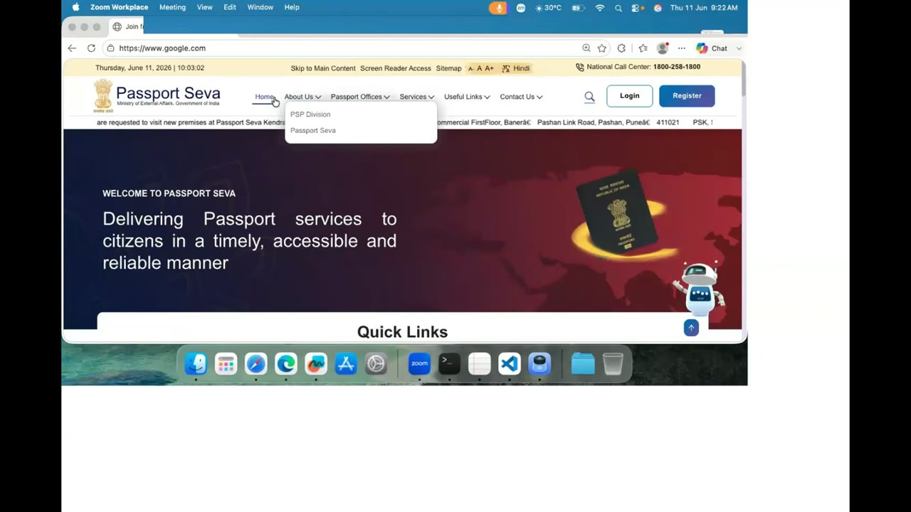

> That means they don't care whether you know or you will use. According to standards, they have to keep. That's the reason they kept it. And whose standards? Who tells all these standards? These are all maintained by a community. Which community that is? W3C, World Wide Web Consortium. Those people maintains the standards of web. I will show you so many such things. For example, we have passport server. This is government of India passport website. Observe government of India passport website. Now in this, they have lot of options. So many services are present. There are so many services here. There are so many things. If a person opens this website, he will be confused. He don't know where which option is available. Am I right? It's very difficult. But do you know, according to the standards,

### f_00-40-48.jpg · video 00:40:48 · transcript 00:40:39

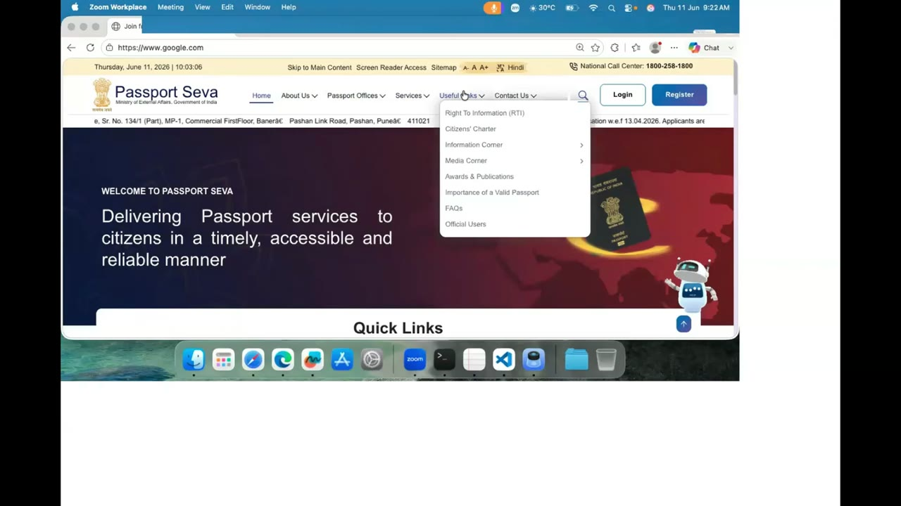

> According to standards, they have to keep. That's the reason they kept it. And whose standards? Who tells all these standards? These are all maintained by a community. Which community that is? W3C, World Wide Web Consortium. Those people maintains the standards of web. I will show you so many such things. For example, we have passport server. This is government of India passport website. Observe government of India passport website. Now in this, they have lot of options. So many services are present. There are so many services here. There are so many things. If a person opens this website, he will be confused. He don't know where which option is available. Am I right? It's very difficult. But do you know, according to the standards, every website should have a sitemap.

### f_00-41-20.jpg · video 00:41:20 · transcript 00:41:11

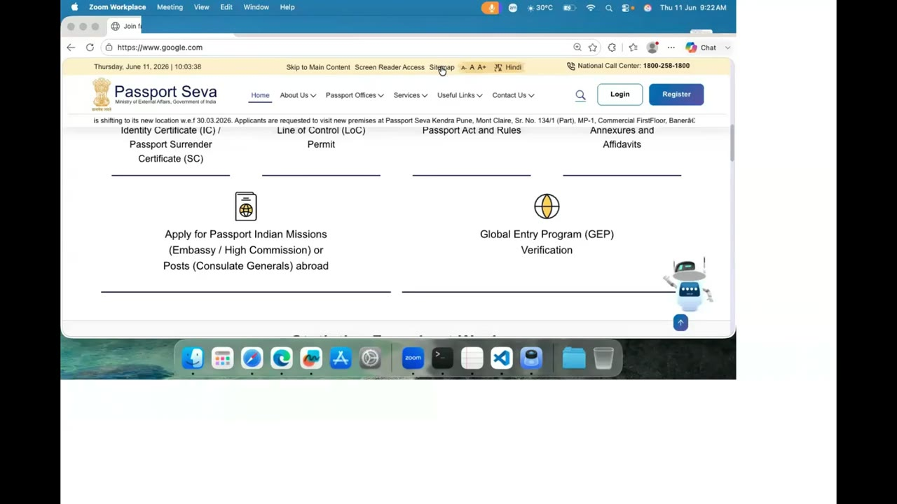

> Observe government of India passport website. Now in this, they have lot of options. So many services are present. There are so many services here. There are so many things. If a person opens this website, he will be confused. He don't know where which option is available. Am I right? It's very difficult. But do you know, according to the standards, every website should have a sitemap. Sitemap means from there user can see whatever everything is provided by that website. Now check, is there any sitemap in this website? You see at the top, you will find a sitemap. There is a small link Sitemap. When I click that sitemap, you will see it will show complete information, where which topic is present. And you can reach to the topic easily. And many people don't know this. Then why they kept it at the top small?

### f_00-41-50.jpg · video 00:41:50 · transcript 00:41:41

> everything is provided by that website. Now check, is there any sitemap in this website? You see at the top, you will find a sitemap. There is a small link Sitemap. When I click that sitemap, you will see it will show complete information, where which topic is present. And you can reach to the topic easily. And many people don't know this. Then why they kept it at the top small? That is because according to the standards, they have to keep. Remember, in our country, it's fine. In US, UK, German, other countries, if they don't follow standards, their country government will ban that website. In our country, it's fine. No problem. But when you are working in other countries' locations, there if you don't follow the standards, that website will be banned. That will be blocked by the government.

### f_00-42-18.jpg · video 00:42:18 · transcript 00:42:09

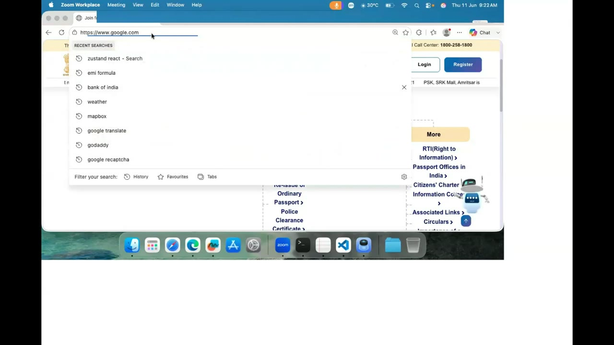

> small? That is because according to the standards, they have to keep. Remember, in our country, it's fine. In US, UK, German, other countries, if they don't follow standards, their country government will ban that website. In our country, it's fine. No problem. But when you are working in other countries' locations, there if you don't follow the standards, that website will be banned. That will be blocked by the government. So we cannot just build with what knowledge we are having. We have to build according to the standards, and you have to learn the standards. And those all standards are defined by which group? Which community? W3C. So, what is web? I hope everyone understood. What is web? Web is a portion of internet with restricted access.

## 08-Phase8-Layers-of-Web.md

### f_00-42-52.jpg · video 00:42:52 · transcript 00:42:43

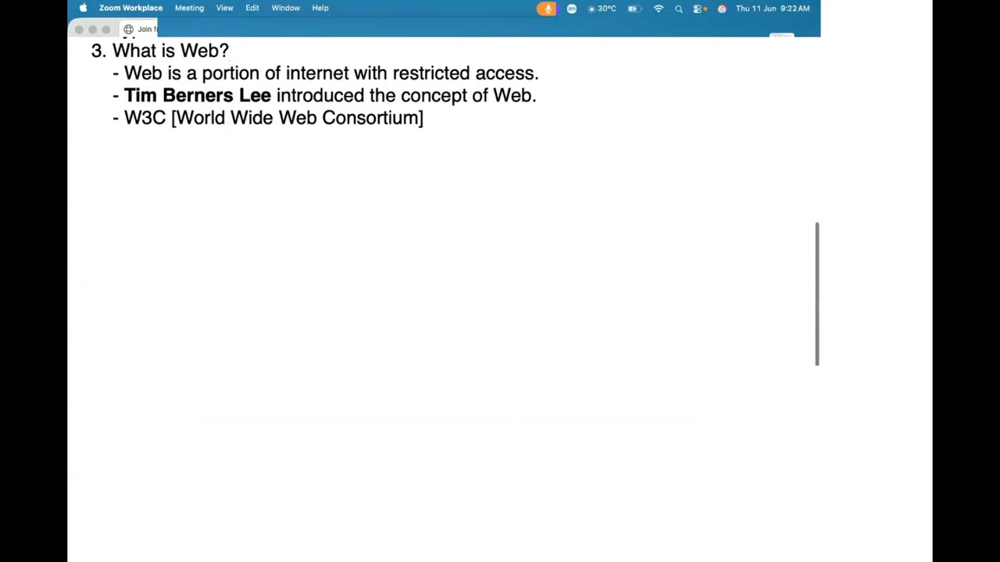

> We have to build according to the standards, and you have to learn the standards. And those all standards are defined by which group? Which community? W3C. So, what is web? I hope everyone understood. What is web? Web is a portion of internet with restricted access. You can control what, where, which one user can watch. He can access. Who developed this concept? Tim Berners-Lee. Who is maintaining these standards? W3C maintain the standards. And I hope you people know another point is, I hope you people know Layers of web. Do you know, actually, internet has three layers. Web has three layers. We have surface web, we have deep web, and we have dark web.

### f_00-43-18.jpg · video 00:43:18 · transcript 00:43:09

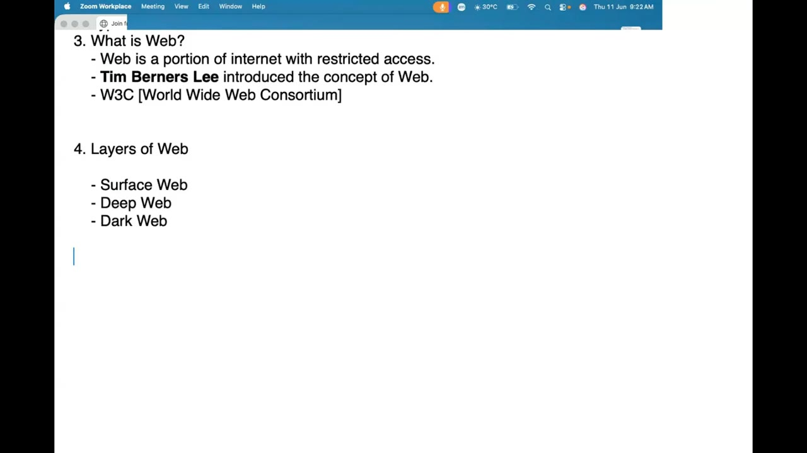

> You can control what, where, which one user can watch. He can access. Who developed this concept? Tim Berners-Lee. Who is maintaining these standards? W3C maintain the standards. And I hope you people know another point is, I hope you people know Layers of web. Do you know, actually, internet has three layers. Web has three layers. We have surface web, we have deep web, and we have dark web. We have three layers of web. Internet is divided into three layers. We have surface, deep, and dark web. I will just show you a point here. Yeah. Actually...

### f_00-43-22.jpg · video 00:43:22 · transcript 00:43:13

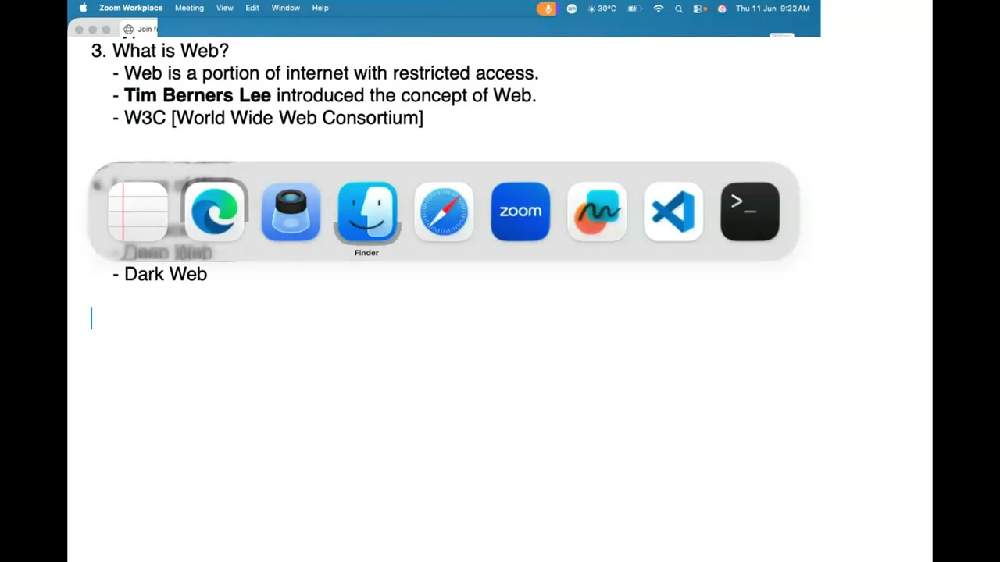

> He can access. Who developed this concept? Tim Berners-Lee. Who is maintaining these standards? W3C maintain the standards. And I hope you people know another point is, I hope you people know Layers of web. Do you know, actually, internet has three layers. Web has three layers. We have surface web, we have deep web, and we have dark web. We have three layers of web. Internet is divided into three layers. We have surface, deep, and dark web. I will just show you a point here. Yeah. Actually... Here, some diagram is there.

### f_00-43-28.jpg · video 00:43:28 · transcript 00:43:19

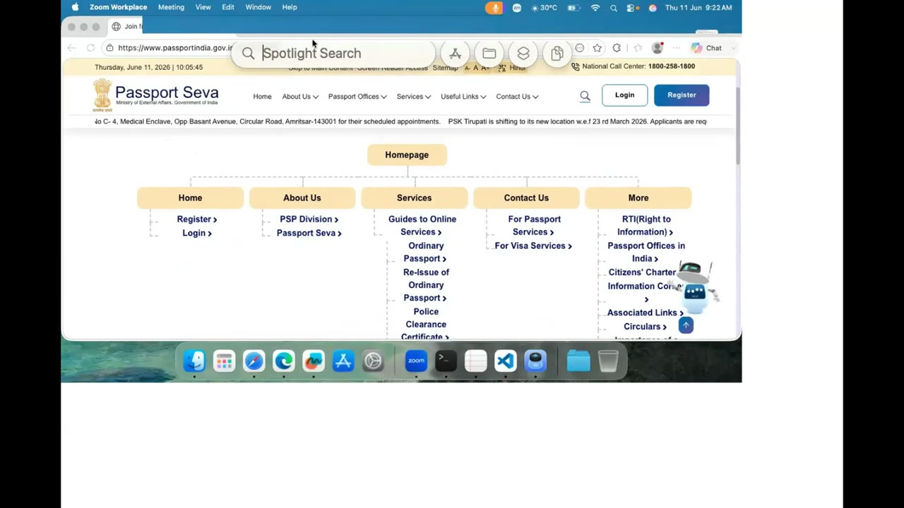

> W3C maintain the standards. And I hope you people know another point is, I hope you people know Layers of web. Do you know, actually, internet has three layers. Web has three layers. We have surface web, we have deep web, and we have dark web. We have three layers of web. Internet is divided into three layers. We have surface, deep, and dark web. I will just show you a point here. Yeah. Actually... Here, some diagram is there. Web layers. Yeah. You can see these are the layers of web, just point I'm showing.

### f_00-43-40.jpg · video 00:43:40 · transcript 00:43:31

> Do you know, actually, internet has three layers. Web has three layers. We have surface web, we have deep web, and we have dark web. We have three layers of web. Internet is divided into three layers. We have surface, deep, and dark web. I will just show you a point here. Yeah. Actually... Here, some diagram is there. Web layers. Yeah. You can see these are the layers of web, just point I'm showing. Web is divided into three layers: surface, deep, and dark. Surface web is the web that you are using every day in your life.

### f_00-44-12.jpg · video 00:44:12 · transcript 00:44:03

> Yeah. Actually... Here, some diagram is there. Web layers. Yeah. You can see these are the layers of web, just point I'm showing. Web is divided into three layers: surface, deep, and dark. Surface web is the web that you are using every day in your life. In your daily life, whatever you are using is surface web, and it is only 5% of internet. Your emails, Instagram, Facebook, whatever you do on internet, it is just only 5%. And you are allowed to access only this 5%. You are not allowed for deep and dark web. Understood? That means you are allowed to access only surface web. Deep web. What is on surface web? Your

### f_00-45-14.jpg · video 00:45:14 · transcript 00:45:05

> Facebook, Instagram or Google, all these are on which web? Surface web. They are on surface web. Deep web means government organizations, private companies, they have their own web. Deep web is nothing but, I will tell you. For example, you have E Seva. Right? Suppose we have a passport office, we have a E Seva, Aadhaar office or some government options are there. Do you know they have their own websites? For example, I will tell you one website. Actually, this is a PFMS. Yeah, this is PFMS. PFMS is Public Finance Management System. It is government of India. Do you know what is this? This is nothing but for government offices all over India.

### f_00-45-46.jpg · video 00:45:46 · transcript 00:45:37

> Do you know they have their own websites? For example, I will tell you one website. Actually, this is a PFMS. Yeah, this is PFMS. PFMS is Public Finance Management System. It is government of India. Do you know what is this? This is nothing but for government offices all over India. All over India, for government offices, this PFMS works, and, CFMS is for every state. Every state have CFMS. Entire India is having PFMS. Do you know what it is? No idea? Actually, what it is, is suppose a government office have to buy a printer, or they have to buy a laptop for their employee in a government office in a state. Earlier, what they have to do, they call tender. Some people will put a tender, they will order, and they will deliver.

### f_00-46-16.jpg · video 00:46:16 · transcript 00:46:07

> and, CFMS is for every state. Every state have CFMS. Entire India is having PFMS. Do you know what it is? No idea? Actually, what it is, is suppose a government office have to buy a printer, or they have to buy a laptop for their employee in a government office in a state. Earlier, what they have to do, they call tender. Some people will put a tender, they will order, and they will deliver. And a lot of money issues. That means they buy a book, they buy a pencil, paper or printer. They buy for 500 rupees, they put bill for 50,000. This is problem government is facing. That is the reason they introduced this. Do you know this is like shopping for Indian government? Like Amazon. What government office people can do, they can open this, they can order what they want. They want 10 laptops for their

### f_00-46-46.jpg · video 00:46:46 · transcript 00:46:37

> And a lot of money issues. That means they buy a book, they buy a pencil, paper or printer. They buy for 500 rupees, they put bill for 50,000. This is problem government is facing. That is the reason they introduced this. Do you know this is like shopping for Indian government? Like Amazon. What government office people can do, they can open this, they can order what they want. They want 10 laptops for their office in Hyderabad at a location. They can order here, they will deliver. That means everything is transparent. How much money is paid, how much money is spent on that, everything is transparent. And do you know, this website I can open, but I cannot log in. I cannot access this from anywhere. I have to access only from their office. I can't log into this. You cannot log in. Even their employees cannot log in from their home.

### f_00-47-16.jpg · video 00:47:16 · transcript 00:47:07

> office in Hyderabad at a location. They can order here, they will deliver. That means everything is transparent. How much money is paid, how much money is spent on that, everything is transparent. And do you know, this website I can open, but I cannot log in. I cannot access this from anywhere. I have to access only from their office. I can't log into this. You cannot log in. Even their employees cannot log in from their home. They have to log in only from their office. That means it is designed in such a way that it will even detect your IP address. It will detect your Wi-Fi also. Do you know your bank apps, when you open a bank app with a Wi-Fi, they give an warning. They say that, "You are connecting with Wi-Fi. Are you sure?" Have you seen that? Right. That means it even detects that which Wi-Fi you are using.

### f_00-47-46.jpg · video 00:47:46 · transcript 00:47:37

> They have to log in only from their office. That means it is designed in such a way that it will even detect your IP address. It will detect your Wi-Fi also. Do you know your bank apps, when you open a bank app with a Wi-Fi, they give an warning. They say that, "You are connecting with Wi-Fi. Are you sure?" Have you seen that? Right. That means it even detects that which Wi-Fi you are using. If you are using from another Wi-Fi, not the office Wi-Fi, then they will immediately disconnect you. They will not allow you access. This is not general web. This is called as what? Deep web. And almost all private organizations and companies, their professional websites, government professional websites, are maintained in deep web. They are accessible by only their employees, only by those employees, only through their Wi-Fi.

### f_00-48-04.jpg · video 00:48:04 · transcript 00:47:55

> They say that, "You are connecting with Wi-Fi. Are you sure?" Have you seen that? Right. That means it even detects that which Wi-Fi you are using. If you are using from another Wi-Fi, not the office Wi-Fi, then they will immediately disconnect you. They will not allow you access. This is not general web. This is called as what? Deep web. And almost all private organizations and companies, their professional websites, government professional websites, are maintained in deep web. They are accessible by only their employees, only by those employees, only through their Wi-Fi. You cannot access everywhere. This is the concept of deep web. I hope everyone understood. And what is dark web? Actually, dark web is meant for military operations, armed forces operations. Their documents information is kept. But it is being used for lot of illegal activities.

### f_00-48-38.jpg · video 00:48:38 · transcript 00:48:29

> by those employees, only through their Wi-Fi. You cannot access everywhere. This is the concept of deep web. I hope everyone understood. And what is dark web? Actually, dark web is meant for military operations, armed forces operations. Their documents information is kept. But it is being used for lot of illegal activities. And if you try to open this dark web, you try to connect. To access dark web, you need special browsers. Yeah, you need special browsers. If you try to access, you try to connect. That means by the time you open the website, at your doorstep, police will be there. That means you are continuously monitored from where you are watching, what you are watching, everything is transparent. And it is not legal to go to dark web. Not legal to go to dark web. Don't ever attempt to use it also.

### f_00-50-18.jpg · video 00:50:18 · transcript 00:50:09

> From other servers, other locations, they use it. So web is categorized into how many layers? Three layers. So you can develop apps for all three. Do you know, this is, I showed you, this is also built by using HTML, CSS. Dark web or surface web or deep web, all websites are built with our concepts. Do you know Government of India is using React JS for front-end? For all government websites in the front-end, they are using React JS, and for all their business transactions, they are using SAP. People call it as SAP. They are using SAP for business transactions. Then in the front-end they are using React. So this is one just example I told you, actually. And observe carefully, the front-end is React and you see there is ASPX, means it is .NET technology.

### f_00-50-44.jpg · video 00:50:44 · transcript 00:50:35

> For all government websites in the front-end, they are using React JS, and for all their business transactions, they are using SAP. People call it as SAP. They are using SAP for business transactions. Then in the front-end they are using React. So this is one just example I told you, actually. And observe carefully, the front-end is React and you see there is ASPX, means it is .NET technology. If it is JSP, means Java. If it is ASPX, that means it is in .NET. .NET and React. So depending on technologies. So now the point is, I hope everyone is clear, what is surface web, deep web and dark web. Is it clear? What is web and what are the types of networks, layers of web. Another important you should know

### f_00-50-56.jpg · video 00:50:56 · transcript 00:50:47

> People call it as SAP. They are using SAP for business transactions. Then in the front-end they are using React. So this is one just example I told you, actually. And observe carefully, the front-end is React and you see there is ASPX, means it is .NET technology. If it is JSP, means Java. If it is ASPX, that means it is in .NET. .NET and React. So depending on technologies. So now the point is, I hope everyone is clear, what is surface web, deep web and dark web. Is it clear? What is web and what are the types of networks, layers of web. Another important you should know is web versions. Web versions. Do you know we are in which

## 09-Phase9-Generations-of-Web.md

### f_00-51-28.jpg · video 00:51:28 · transcript 00:51:19

> So now the point is, I hope everyone is clear, what is surface web, deep web and dark web. Is it clear? What is web and what are the types of networks, layers of web. Another important you should know is web versions. Web versions. Do you know we are in which generation of web? Any idea? For all java .NET people interview, they ask which generation of web you are currently in. If you say, "I don't know," they kick you out. That's it. That means no use of Java .NET or Python-like developers to put that. After all, you don't know in which generation of web you are working. Actually, there are four generations of web. Now we are in which generation of web? Fourth.

### f_00-51-52.jpg · video 00:51:52 · transcript 00:51:43

> Web versions. Do you know we are in which generation of web? Any idea? For all java .NET people interview, they ask which generation of web you are currently in. If you say, "I don't know," they kick you out. That's it. That means no use of Java .NET or Python-like developers to put that. After all, you don't know in which generation of web you are working. Actually, there are four generations of web. Now we are in which generation of web? Fourth. Fourth generation of web. Actually, I will show you a point. So four generations of web is present. We are in the fourth generation. That means how many versions are there? These are the generations. This is the generation

### f_00-51-58.jpg · video 00:51:58 · transcript 00:51:49

> Any idea? For all java .NET people interview, they ask which generation of web you are currently in. If you say, "I don't know," they kick you out. That's it. That means no use of Java .NET or Python-like developers to put that. After all, you don't know in which generation of web you are working. Actually, there are four generations of web. Now we are in which generation of web? Fourth. Fourth generation of web. Actually, I will show you a point. So four generations of web is present. We are in the fourth generation. That means how many versions are there? These are the generations. This is the generation of web. The first generation, first version,

### f_00-52-04.jpg · video 00:52:04 · transcript 00:51:55

> of web you are currently in. If you say, "I don't know," they kick you out. That's it. That means no use of Java .NET or Python-like developers to put that. After all, you don't know in which generation of web you are working. Actually, there are four generations of web. Now we are in which generation of web? Fourth. Fourth generation of web. Actually, I will show you a point. So four generations of web is present. We are in the fourth generation. That means how many versions are there? These are the generations. This is the generation of web. The first generation, first version, 1990s, we have static web. That means when Internet started, when web started, everything was

### f_00-52-36.jpg · video 00:52:36 · transcript 00:52:27

> four generations of web is present. We are in the fourth generation. That means how many versions are there? These are the generations. This is the generation of web. The first generation, first version, 1990s, we have static web. That means when Internet started, when web started, everything was static. Static means what? You can just access and watch what they provide. You cannot interact. That means you ask something, they will respond to you. That's not happening. That is the first generation. First generation started in 1990. Tim Berners-Lee introduced web in 1990. When he developed web, what is the concept? Web works with static. Everything static. Dynamic started in 2000. In the year 2000, dynamic web started.

### f_00-55-42.jpg · video 00:55:42 · transcript 00:55:33

> How many versions of web are there? Four versions of web. Currently we are in fourth. So what is difference? Tell me. Tell me what you remembered. First version. So first version, 1990s. 1990s, what is it? Static web. So do you remember the technologies? So we have technologies, HTML, CSS, all these come under. In 2000? So in 2000, we have dynamic web. You have JSP, Java, PHP, ASP, all these are dynamic. In 2010, we have what? SPA, single-page application. They are done with technologies like Angular, React, Vue, all these. We have another one, 2020s. 2020s onwards, we are using AI.

## 10-Phase10-Web-Principles.md

### f_00-56-12.jpg · video 00:56:12 · transcript 00:56:03

> So we have technologies, HTML, CSS, all these come under. In 2000? So in 2000, we have dynamic web. You have JSP, Java, PHP, ASP, all these are dynamic. In 2010, we have what? SPA, single-page application. They are done with technologies like Angular, React, Vue, all these. We have another one, 2020s. 2020s onwards, we are using AI. In this generation, we have chatbots. These are chatbots. So chatbots and so many AI agents will be there. Now we are in the fourth generation. We are in the fourth generation of web. If anyone asks, what is this fourth generation? It is nothing but web with combination of AI, artificial intelligence. So these are versions of web. Next important, you should

### f_00-56-42.jpg · video 00:56:42 · transcript 00:56:33

> In this generation, we have chatbots. These are chatbots. So chatbots and so many AI agents will be there. Now we are in the fourth generation. We are in the fourth generation of web. If anyone asks, what is this fourth generation? It is nothing but web with combination of AI, artificial intelligence. So these are versions of web. Next important, you should know about web principles. We should know about web principles. Do you know to build a website, we have to follow four principles? Every web designing contains four principles. Web development have four principles. What are the four principles? Accessibility. We have accessibility.

### f_00-57-10.jpg · video 00:57:10 · transcript 00:57:01

> So these are versions of web. Next important, you should know about web principles. We should know about web principles. Do you know to build a website, we have to follow four principles? Every web designing contains four principles. Web development have four principles. What are the four principles? Accessibility. We have accessibility. We have internationalization. Internationalization. We have privacy and security. These are four principles of web. We need to build website with these principles. When you are building a website or a web application, every website, web application must follow four principles. What are those? Accessibility, internationalization, privacy, and

### f_00-57-28.jpg · video 00:57:28 · transcript 00:57:19

> Every web designing contains four principles. Web development have four principles. What are the four principles? Accessibility. We have accessibility. We have internationalization. Internationalization. We have privacy and security. These are four principles of web. We need to build website with these principles. When you are building a website or a web application, every website, web application must follow four principles. What are those? Accessibility, internationalization, privacy, and security. And I will show you, this is the official website, w3.org. And this is the official website. You can see it says that World Wide Web Consortium develops the standards and

### f_00-57-32.jpg · video 00:57:32 · transcript 00:57:23

> Accessibility. We have accessibility. We have internationalization. Internationalization. We have privacy and security. These are four principles of web. We need to build website with these principles. When you are building a website or a web application, every website, web application must follow four principles. What are those? Accessibility, internationalization, privacy, and security. And I will show you, this is the official website, w3.org. And this is the official website. You can see it says that World Wide Web Consortium develops the standards and guidelines for everyone to build

### f_00-58-06.jpg · video 00:58:06 · transcript 00:57:57

> Accessibility, internationalization, privacy, and security. And I will show you, this is the official website, w3.org. And this is the official website. You can see it says that World Wide Web Consortium develops the standards and guidelines for everyone to build websites. And what are the principles? Four principles are there. What is it? Accessibility, internationalization, privacy, and security. You have to follow these four principles to build websites. Detailing, we will see later. First, simple I will tell you. What is accessibility means, I will tell you. One simple concept is web accessibility, you will learn later. You will understand about web accessibility. Here we are having keyboard or not. I will show you one simple point. You have laptops, and everywhere

### f_01-02-30.jpg · video 01:02:30 · transcript 01:02:21

> college? They don't fit for real-time. Why they don't fit for real-time? Because they learn the concept, but they don't know the standards of concept. 100% everybody. Even you finished your course and you go to any company, and they will be irritated with your work. Company people will be irritated with your work. They scold you regularly saying that, "Where you learnt? You don't know the standards. Why you are writing code like this?" You will hear that. We have to avoid that. How we can avoid? By learning a technology according to the standards. If you learn according to the standards, you can implement as per the standards in real-world scenarios. I hope you are clear. So we are going to build web applications, then we should know minimum concept about web. I hope up to this, everyone clear what is web, and what are the layers of web, what are the versions of web, and what are the principles, web

### f_01-02-36.jpg · video 01:02:36 · transcript 01:02:27

> Why they don't fit for real-time? Because they learn the concept, but they don't know the standards of concept. 100% everybody. Even you finished your course and you go to any company, and they will be irritated with your work. Company people will be irritated with your work. They scold you regularly saying that, "Where you learnt? You don't know the standards. Why you are writing code like this?" You will hear that. We have to avoid that. How we can avoid? By learning a technology according to the standards. If you learn according to the standards, you can implement as per the standards in real-world scenarios. I hope you are clear. So we are going to build web applications, then we should know minimum concept about web. I hope up to this, everyone clear what is web, and what are the layers of web, what are the versions of web, and what are the principles, web principles. Can you tell me what web contains? One more thing we will see.

## 11-Phase11-What-Web-Contains.md

### f_01-03-18.jpg · video 01:03:18 · transcript 01:03:09

> about web. I hope up to this, everyone clear what is web, and what are the layers of web, what are the versions of web, and what are the principles, web principles. Can you tell me what web contains? One more thing we will see. Web comprises of what? Web comprises of lot of things, like web contains website, web contains web application, web contains blogs, web contains microblogs, web contains Wikipedia, wikis, web contains podcasts, podcasting, web contains widgets. These are all the concepts of web. And you people know only one thing, website. And everything on web is not website. Web has a lot of things.

### f_01-03-44.jpg · video 01:03:44 · transcript 01:03:35

> Web comprises of lot of things, like web contains website, web contains web application, web contains blogs, web contains microblogs, web contains Wikipedia, wikis, web contains podcasts, podcasting, web contains widgets. These are all the concepts of web. And you people know only one thing, website. And everything on web is not website. Web has a lot of things. That means web is not website. Web has lot of concepts. For example, what do you call Spotify? You have Spotify. What do you call this Spotify? Website? You call it as a website? It's not a website, it is called podcaster.

### f_01-03-52.jpg · video 01:03:52 · transcript 01:03:43

> contains blogs, web contains microblogs, web contains Wikipedia, wikis, web contains podcasts, podcasting, web contains widgets. These are all the concepts of web. And you people know only one thing, website. And everything on web is not website. Web has a lot of things. That means web is not website. Web has lot of concepts. For example, what do you call Spotify? You have Spotify. What do you call this Spotify? Website? You call it as a website? It's not a website, it is called podcaster. Podcaster. Why it is called podcaster, do you know? I can click on a song. I can listen the song on my laptop,

### f_01-04-26.jpg · video 01:04:26 · transcript 01:04:17

> Spotify? You have Spotify. What do you call this Spotify? Website? You call it as a website? It's not a website, it is called podcaster. Podcaster. Why it is called podcaster, do you know? I can click on a song. I can listen the song on my laptop, or I can connect with any remote TV and broadcast there. I can connect to Bluetooth speakers and broadcast there. You know this? Then this is not website. This is called podcaster. YouTube is not a website. It is a podcaster. And if you say YouTube website, that means people will treat you like software illiterates. That's what problem with basic learners. They don't know what it is, but they work with it.

## 12-Phase12-Wrap-Up-QA.md

### f_01-05-36.jpg · video 01:05:36 · transcript 01:05:27

> how much you can work, on how much knowledge you have about it. That means they need technically correct knowledge. And very important, we will have a complete clarity on all this. We will learn what is difference between website, web application, and all this. So first, we are going to start with what? Actually, we are going to build what? Web application. And if you know web application, then you can handle others also. What is difference between them? I will tell you. We'll discuss about them one by one. So first, we are going to start with which one? We are going to start with web application. If you can build web application, you can handle others. So we will start practically now working with this concept. That means practically means how to install, how to set up what you need to have in your computer, everything I will explain, you need to do that. Practically, we need to implement that. That we'll see in our next session.

### f_01-08-16.jpg · video 01:08:16 · transcript 01:08:07

> and in this we will post all the course content and what topics we are going to learn, everything into this. And I will share a Google Classroom link also there, where I will upload all the notes. Okay, then tomorrow we can continue with this. If any people have any doubts, you can stay, I can get back to you. Any people have any doubts? You can stay and raise hand, online people, I can get back to you in a while. It's a WhatsApp community link. Working? Use your Google Lens if it is not working. Through Google Lens you can directly get it easily. Google Lens is there now.

### f_01-08-40.jpg · video 01:08:40 · transcript 01:08:31

> I can get back to you. Any people have any doubts? You can stay and raise hand, online people, I can get back to you in a while. It's a WhatsApp community link. Working? Use your Google Lens if it is not working. Through Google Lens you can directly get it easily. Google Lens is there now.

## after last phase

### f_01-19-14.jpg · video 01:19:14 · transcript 01:19:05

> So, okay. So if you are clear with this concept, then we will continue on tomorrow's session. Thank you very much, everyone.

