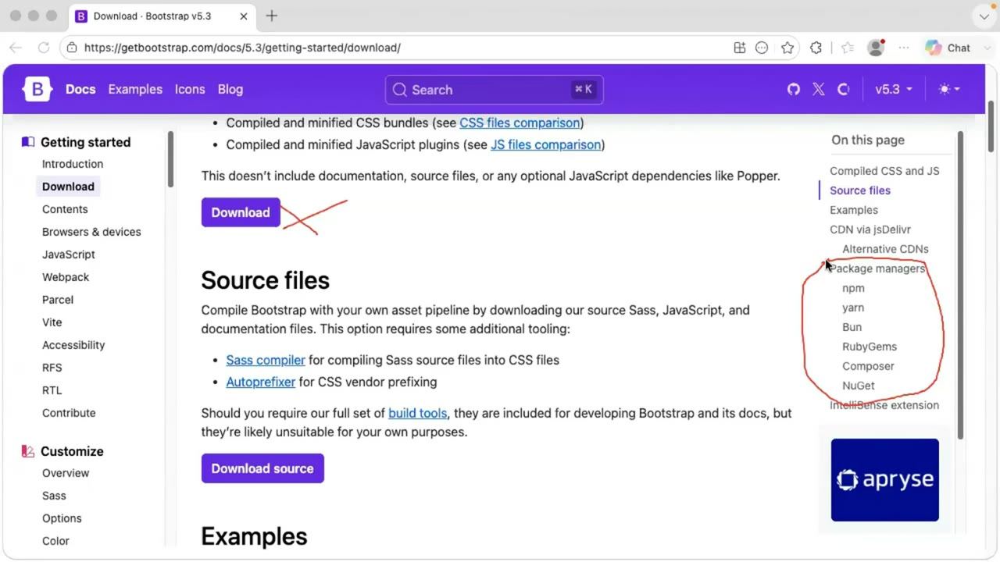

# 5️⃣ Phase 5 · NPM in Action: Install & Update Bootstrap

**⏱️ 24:35 – 30:31** · 📂 S02 Dev Environment Setup · [⬅️ Prev](04-Phase4-NPM-Package-Managers.md) · [Next ➡️](06-Phase6-VS-Code-Editor.md)

---

## ⏱️ 24:35 – 25:03 · 🧩 Manual Path-Setting Is Outdated

🔑 **Key points**
- 🛤️ *"Even today, several Java, Python … people have to set a lot of paths manually."* In the current generation, doing everything manually *"is not great"* (as said).

---

## ⏱️ 25:03 – 25:55 · 🧩 One Command Instead ⭐

🔑 **Key points**
- 📦 With a package manager (ours is **NPM**), run one command:
```bash
npm install bootstrap
```
- 🎬 **Seen on screen** (25:31): the command is not run in a terminal. The instructor writes it in red, as an on-screen annotation, on Bootstrap's download page next to the **Download** button:
```text
> npm install bootstrap
```
- 🤖 It automatically **downloads** the library, **copies** the files, **creates a new folder** in your project and **saves** them there. *"Now you can just start using it."*
- 👷 *"Every software developer has to use this package manager."*

```
  ⌨️ npm install bootstrap
        │
        ├── 📥 download library
        ├── 📋 copy all files
        ├── 📁 create folder in your project
        └── 💾 save files there ──► ✅ ready to use
```

---

## ⏱️ 25:55 – 26:23 · 🧩 Updating to a New Version

🔑 **Key points**
- 🆕 The library's authors release a **new version** later.
- ❌ Manual: go to the project, delete old files, download new files, copy them: *"all risky"*.
- ✅ With NPM (🗣️ **said, not seen typed:** the command is spoken at 26:12; no captured frame shows it written, and by 26:31 the red annotation is gone):
```bash
npm update bootstrap
```
- 🔄 It updates to the **latest version** automatically.

🧠 **Hook:** *`npm install` to add · `npm update` to refresh.*

---

## ⏱️ 26:23 – 27:00 · 🧩 Bootstrap's Own Site Recommends Package Managers 🛠️

🔑 **Key points**
- 🌐 On the Bootstrap website: *instead of downloading, you can use package managers.*
- 📋 Listed there: **NPM, Yarn, Bun, RubyGems, Composer, NuGet**.
- 🎬 **Seen on screen** (27:01): on `https://getbootstrap.com/docs/5.3/getting-started/download/` the instructor **crosses out the Download button** in red and **circles the "Package managers" group** in the page's "On this page" menu.



```text
  On this page
    Compiled CSS and JS
    Source files
    Examples
    CDN via jsDelivr
      Alternative CDNs
    Package managers      ◄── circled in red
      npm
      yarn
      Bun
      RubyGems
      Composer
      NuGet
    IntelliSense extension

  [ Download ]  ✗  crossed out in red
```

---

## ⏱️ 27:00 – 27:56 · 🧩 NPM Is Enough

🔑 **Key points**
- 🎁 **NPM** comes with Node.js; the **others must be downloaded and installed** separately.
- ⚖️ The difference between package managers: *"some features are different."*
- ✅ **NPM is enough** for everything until you learn React, Angular, Node.js, anything. *"All libraries in the world use NPM very much."*

---

## ⏱️ 28:03 – 29:00 · 🧩 Q&A: Checking NPM & Installing an Older Version

🔑 **Key points**
- ❓ Student check: `npm -v` gets the NPM **version** (already given in P3).
- 🔢 To install an **older version** of something, you **put the version number** in the install command (as said). How to install is taught later.

> 🎬 **Seen on screen** (28:51): while answering, the instructor starts typing the syntax in the notes file, below the package-manager list. The one captured frame catches it mid-word, and by 29:03 the line has been deleted again:
>
> ```text
> >npm install bootstrap@vers
> ```
>
> The syntax was never read out and the finished line was not captured.

> ⚠️ **Accuracy note:** the real syntax is the package name, an `@`, then the version number, for example `npm install bootstrap@5.3.8`.

---

## ⏱️ 29:00 – 30:31 · 🧩 Recap + Important Note ⭐

🔑 **Key points**
```
  🟢 Node.js  ── installed for building web applications
  📦 NPM      ── comes with Node.js; downloads, updates, installs and
                 uninstalls any library a project needs, using commands

  📝 NOTE: make sure  Node ≥ 20  and  NPM ≥ 10
```
- 🎬 **Seen on screen** (30:25): the block above is this page's summary. What is actually typed in the notes file, right under the package-manager list, is this one line ("Note:" in bold; the doubled `>` and `+` are the instructor's wording `[sic]`):
```text
Note: Make sure that Node is > 20+ version and NPM is > 10+ version.
```

---

## 💻 Complete Code

```bash
# Install the Bootstrap library into your project
npm install bootstrap

# Later: update Bootstrap to its latest version   (said, not seen typed)
npm update bootstrap
```

> 🛠️ These commands are shown as concepts in this session; you'll run them practically later (as said).

> 🎬 **Seen on screen:** `npm install bootstrap` is written once, as a red annotation over Bootstrap's download page (25:31); neither command is run in a terminal in this session. `npm update bootstrap` is spoken only in the captured frames.

---

## ✅ Quick Recall

```
  ☐ The command to install Bootstrap
  ☐ 4 things that command does for you
  ☐ The command to update it
  ☐ 6 package managers listed on Bootstrap's site
  ☐ Why stick with NPM?
  ☐ The version note: Node ≥ ? · NPM ≥ ?
```
