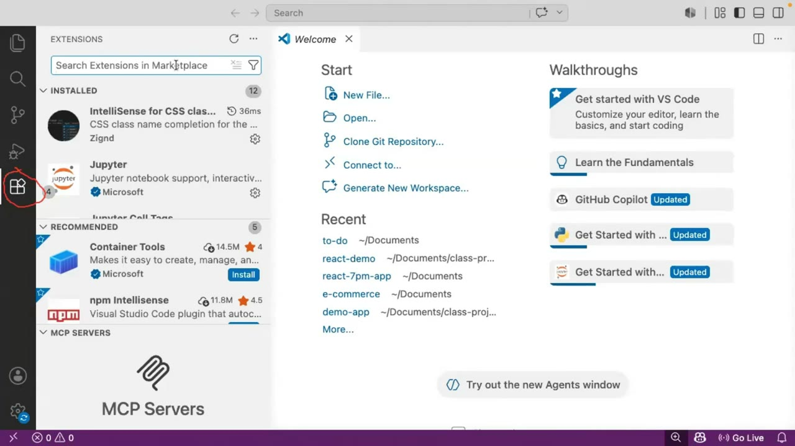

# 7️⃣ Phase 7 · Step ③: Install VS Code Extensions

**⏱️ 37:13 – 41:16** · 📂 S02 Dev Environment Setup · [⬅️ Prev](06-Phase6-VS-Code-Editor.md) · [Next ➡️](08-Phase8-Why-Each-Extension.md)

---

## ⏱️ 37:13 – 38:20 · 🧩 Usable for Any Tech ≠ Ready for Any Tech

🔑 **Key points**
- 🧩 VS Code **can be used** for any technology, but it **isn't ready** for every technology out of the box.
- 🐍 Example: usable for Python, Java, .NET, but **not immediately ready** for them.
- ➕ You must **install extensions**: open VS Code on your PC and install the following ones.
- 🎬 **Seen on screen** (typed by 38:09, in bold):
```text
3. Open visual studio code on your PC and install following extensions
```

🧠 **Hook:** *VS Code + extensions = ready for your technology.*

---

## ⏱️ 38:20 – 39:37 · 🧩 Find the Extensions Button 🛠️

🔑 **Key points**
- 🖥️ Open **Visual Studio Code** (from your programs).
- ⬅️ In the **left panel**, click the **Extensions** button → the extensions list opens.
- 🔍 **Search** for each extension and **install** it.

```
  VS Code
  ┌────┬──────────────────────────────
  │ 📄 │
  │ 🔍 │   🔎 Search Extensions …
  │ 🧩 │◄── Extensions button (left panel)
  │    │   [Install]
  └────┴──────────────────────────────
```

- 🎬 **Seen on screen:** he opens VS Code through Spotlight search (38:37). It first reopens his last project, so he opens the **File** menu (38:43) and the next frame shows the project closed and the **Welcome** page (38:47). He then **circles the Extensions icon in red** (39:09); it is the icon made of four squares, fifth from the top of the left bar. Clicking it opens the panel (39:27):



```text
  ┌────┬─ EXTENSIONS ──────────────────────┬─ Welcome ──────────────
  │ 📄 │ [ Search Extensions in Marketplace ]│  Start
  │ 🔍 │ ▾ INSTALLED                    12  │    New File...
  │ 🌿 │    IntelliSense for CSS clas…      │    Open...
  │ ▶️ │      Zignd                         │    Clone Git Repository...
  │(🧩)│◄── circled in red                  │  Walkthroughs
  │    │ ▾ RECOMMENDED                   5  │    Get started with VS Code
  │    │    Container Tools      [Install]  │    Learn the Fundamentals
  │    │    npm Intellisense                │
  │    │ ▾ MCP SERVERS                      │
  └────┴────────────────────────────────────┴───────────────────────
```

---

## ⏱️ 39:37 – 41:16 · 🧩 The Extensions List ⭐

| # | 🧩 Extension | 👤 Author / publisher (as given) |
|---|---|---|
| 1 | **Live Server** | **Ritwick Dey** (search by this author) |
| 2 | **VS Code Icons** (🎬 typed as `Vscode-Icons`) | VS Code Icons Team (not typed in this phase) |
| 3 | **IntelliSense for CSS class names in HTML** | – (🎬 his installed copy shows publisher **Zignd**, 39:27) |
| 4 | **Live Preview** | – |

- 👤 For Live Server the **author name** matters, because *many* extensions share the name "Live Server" (P8).
- 🎬 **Seen on screen** (typed 39:47 – 40:55; line d) is in place by 41:25). Only Live Server gets an author:
```text
a) Live Server (Ritwick Dey)
b) Vscode-Icons
c) IntelliSense for CSS class names in HTML
d) Live Preview
```
- 🎬 At 39:53 the Extensions panel's INSTALLED list shows **Live Server** ("Launch a development local Server …") with the publisher **Ritwick Dey** underneath.

> 🎬 **Seen on screen:** the transcript says "Ritwik Dey"; the instructor types **Ritwick Dey**, and the Extensions panel shows the same spelling.

---

## 🛠️ Try it

```
  1. Open VS Code → click the Extensions button (left panel)
  2. Search and install:
       ☐ Live Server            (author: Ritwick Dey)
       ☐ VS Code Icons          (search "vscode-icons"; VS Code Icons Team)
       ☐ IntelliSense for CSS class names in HTML
       ☐ Live Preview
```

---

## ✅ Quick Recall

```
  ☐ Why does VS Code need extensions?
  ☐ Where is the Extensions button?
  ☐ The 4 extensions to install
  ☐ Why search Live Server by author name? Which author?
```
