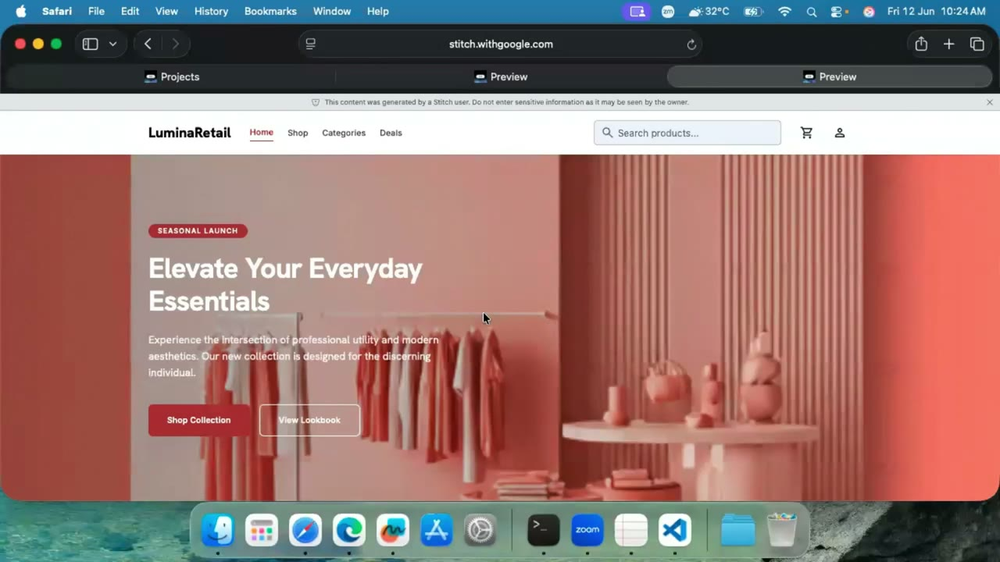

# 🔟 Phase 10 · Stitch with Google & Prompting With Technical Names

**⏱️ 53:19 – 1:02:01** · 📂 S02 Dev Environment Setup · [⬅️ Prev](09-Phase9-Accounts-To-Create.md) · [Next ➡️](11-Phase11-Design-Plan-UI-Vocabulary.md)

---

## ⏱️ 53:19 – 54:01 · 🧩 What Stitch Is For ⭐

🔑 **Key points**
- 🧵 **Stitch with Google** (*"very important"*, used regularly): ask *"I want to design this"* → it **creates a preview** of the design.
- 💡 We use it **every day** to get **design ideas**, then build them ourselves.
- ❌ *"We will not take help of these tools for generating code."*
- 🎬 **Seen on screen (53:27–54:01):** Stitch is opened in Safari at `stitch.withgoogle.com` (the address bar suggestion reads *"Stitch - Design with AI"*). The page shows **Stitch** with a **BETA** tag, the heading *"Welcome to Stitch.."*, a prompt box, and a **My Projects** list of the instructor's earlier designs.

```
  🧵 Stitch ──► 🖼️ design idea / preview ──► 👩‍💻 WE hand-code it (HTML + CSS)
                                      ✖ AI-generated code not used
```

---

## ⏱️ 54:01 – 56:59 · 🧩 "AI Is a Bubble": the Instructor's View 🚫

> 🚫 **Non-technical opinion (as said).** *"We are learning how to code. We don't depend on AI."*

- 🫧 The instructor calls **AI a bubble** that *"is going to blow out any time"*; it's required today and you must know it, *"but we cannot trust it"*.
- 📰 Claims made in class (unverified, as said): Microsoft "recently stopped using AI"; IBM eliminated AI concepts "because of COBOL issues"; AI is getting **costlier**, and small-memory devices/laptops won't handle it in future.
- ⚛️ *"Future of computers is not AI. Future of computers is quantum."*
- 🙉 Problem with AI (as said): *"it will not listen to you at certain stages"*; tools like Claude have "so many issues", so companies can't implement them completely.
- 🏢 TCS story (as said): TCS will hire the same number of people, but replace **people without AI knowledge** with **people with AI knowledge**.

🧠 **Hook (as taught):** *Know AI, use AI, but don't depend on AI to write your code.*

---

## ⏱️ 56:59 – 57:49 · 🧩 Prompt Engineering Basics Will Be Taught

🔑 **Key points**
- 🌐 In Stitch, choose the **Web** category, then type your prompt.
- 🎬 **Seen on screen (57:03–57:35):** the "category" is a pair of buttons under the prompt box, **App** and **Web**. With App active the box asks *"What native mobile app shall we design?"*; after he clicks **Web** it asks *"What responsive web experience shall we design?"*. The model chip beside them reads **3 Flash**.
- 🧠 Basics of **generative AI / prompt engineering** will be taught in this course: *how to talk with AI* so you get **correct, exact results**.

---

## ⏱️ 57:49 – 58:58 · 🧩 Demo Prompt: Online Shopping Homepage 🛠️

🔑 **Key points**
- ⌨️ The prompt the instructor types. 🎬 **Seen on screen (58:39), copied exactly.** It is one bullet in the prompt box, with the parts separated by `*` (spacing as typed; the line break here is only to fit the page):
```text
• Create an online shopping home page  * Header with search , brand and navigation
  *Section with featured products in cards * Footer with services and contact details
```
- 🗣️ **Said, not typed:** he narrates the third part as *"Section with featured products, products in cards"*; the typed text is just `Section with featured products in cards`. The four parts, read as a list: page · header · featured-products section · footer.
- ▶️ Click **Generate** → Stitch generates a simple UI. 🎬 The button is the round **↑** arrow at the bottom-right of the prompt box; its tooltip reads **Generate**.
- 🎬 **What Stitch does next (59:05–59:11):** it opens a project it names **E-Commerce Storefront Homepage** and replies: *"I'm designing a professional online shopping home page for you. I'll start by creating a consistent design system, followed by the main home page featuring a searchable header, product showcase, and service-focused footer."* Status lines follow (*"Building the design system"*), and a design-system board (colour swatches, `Aa` type samples, buttons, a search field) appears before the page itself.
- ⚠️ To design such UIs you **need technical knowledge**; without it, AI *"cannot give you exactly what you are looking for"*.

> 🎬 **Seen on screen (58:39):** the typed prompt says `featured products in cards`. So the transcript's "products in carts" is **products in cards**.

---

## ⏱️ 58:58 – 1:00:02 · 🧩 Name the Parts: Header & Hero Banner ⭐

🔑 **Key points**
- 🌐 The instructor opens sample **website templates** (e-commerce…).
- 🎬 **Seen on screen (59:27–1:00:59):** the templates come from **Colorlib**. Path taken:

```text
https://colorlib.com                           category tiles: Business · Portfolio ·
                                               eCommerce · Restaurant · Medical · Education ·
                                               Construction · Wedding · Hotel · Real Estate ·
                                               Fitness · Travel
https://colorlib.com/wp/cat/ecommerce/         template list (SoleStyle, Shopper, Ashion …)
https://colorlib.com/wp/template/coza-store/   the template he explains: "Coza Store"
```

- 🎬 The layout below is the **Coza Store** template as shown (the footer was not scrolled to):
```
  ┌────────────────────────────────────────────────────────────┐
  │ HEADER  COZA STORE  Home Shop Features Blog About Contact  │
  │                                    search · cart · wish    │
  ├────────────────────────────────────────────────────────────┤
  │ HERO BANNER   "Men Collection 2018"                        │
  │               NEW ARRIVALS            (photo of a model    │
  │               [ SHOP NOW ]             on the right)       │
  ├────────────────────────────────────────────────────────────┤
  │ [Women] [Men] [Accessories]   ◄── boxes below the hero     │
  ├────────────────────────────────────────────────────────────┤
  │ FOOTER   (not shown on this template)                      │
  └────────────────────────────────────────────────────────────┘
```
- 🏷️ The top bar → **header**. The big photo area with a shop option → **hero banner**.

---

## ⏱️ 1:00:02 – 1:00:42 · 🧩 Technical Names Make Short Prompts

🔑 **Key points**
- ❌ *"I want one person right side, one button left side, one border, one text left to right…"* → like *"an illiterate talking with AI"* (as said), and a waste of time.
- ✅ *"I just want a hero banner with an image."* → it generates it.
- 🎓 That is what **prompt engineering** and **web technology** teach you.

🧠 **Hook:** *Know the name → write a one-line prompt.*

---

## ⏱️ 1:00:42 – 1:00:57 · 🧩 Cards

🔑 **Key points**
- 🃏 The product boxes are called **cards**. Ask for *cards* and it generates cards.
- 🎬 On screen around this moment (1:00:07, 1:00:59) the boxes in view are the three category boxes of the Coza Store template: **Women**, **Men**, **Accessories**.

---

## ⏱️ 1:00:57 – 1:02:01 · 🧩 The Generated UI & Your Job

🔑 **Key points**
- 👀 Select the result → **Preview** → **Open in a new tab**.
- 🎬 **Seen on screen (1:01:09):** with the generated screen selected, a toolbar shows **Generate · Modify · Preview · More**. The **Preview** menu lists **New Tab**, **Show QR Code** and **Mobile**; he picks **New Tab**. The preview tab carries the notice *"This content was generated by a Stitch user. Do not enter sensitive information as it may be seen by the owner."*
```
  ✅ header with search bar
  ✅ hero banner
  ✅ featured products as CARDS   (because the prompt asked for cards)
  ✅ footer with services & contact
```
- 🎬 **The generated page, as shown (1:01:25–1:01:41, and again at 1:02:05):**



```text
HEADER    LuminaRetail | Home · Shop · Categories · Deals | [Search products...] cart, user
HERO      tag "SEASONAL LAUNCH"
          "Elevate Your Everyday Essentials"
          buttons: [Shop Collection] [View Lookbook]
SECTION   "Featured Products"  ·  "See All Products →"
          4 cards, each: photo · category · name · price · [Add to Cart]
            WATCHES      Quartz Chronograph    $299.00
            FOOTWEAR     Performance Velocity  $155.00   (badge: HOT)
            ELECTRONICS  Studio Sound Pro      $420.00
            BEAUTY       Essence No. 4         $120.00
(one more section with a picture sits between the cards and the footer; unreadable)
FOOTER    LuminaRetail + short description
          Shop:      All Products · New Arrivals · Best Sellers · Sale
          Resources: Shipping · Returns · Support · Contact Us
          Company:   About Us · Careers · Terms of Service · Privacy Policy
          "© 2024 LuminaRetail. Modern Professionalism in Commerce."
```
- 🎬 The footer's **Resources** column (Shipping, Returns, Support, Contact Us) is what answers the prompt's "services and contact details"; the cursor rests on **Support** in the footer frame (1:01:41).
- 💻 Stitch **can also give the code**, *"but we will not take it. We will design it."*
- 🎯 **Your job as a learner: build this yourself.**

---

## 🛠️ Try it

```
  1. Sign in to Stitch with Google → choose the Web category
  2. Enter the 4-part shopping-homepage prompt above → Generate
  3. Preview → open in a new tab
  4. Point out: header · hero banner · cards · footer
```

---

## ✅ Quick Recall

```
  ☐ What do we use Stitch for, and what do we NOT use it for?
  ☐ The 4 parts of the demo prompt
  ☐ Name: the top bar? the big photo area? the product boxes?
  ☐ Why do technical names matter when prompting?
  ☐ Instructor's view on AI vs the future of computing (as said)
```
