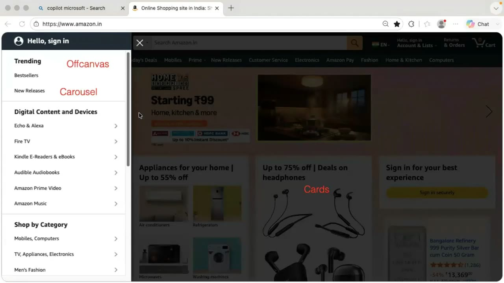

# 1️⃣1️⃣ Phase 11 · The Design Plan & UI Vocabulary

**⏱️ 1:02:01 – 1:06:40** · 📂 S02 Dev Environment Setup · [⬅️ Prev](10-Phase10-Stitch-And-Prompting.md) · [Next ➡️](12-Phase12-Wrap-Up.md)

---

## ⏱️ 1:02:01 – 1:02:58 · 🧩 Build This Page in ~10 Days ⭐

🔑 **Key points**
- 📅 Within **10 days of starting HTML**, the class will build the generated shopping page **as it is**.
- 🎨 HTML and CSS run **simultaneously**: by the end of HTML, CSS is also done.
- 🗓️ *"In the matter of one month, you are going to build websites"*, live in class.
- 🤖 Workflow: no "imagination jobs"; **ask an AI tool to generate** the design, then **create it**.

```
  🧵 AI generates design ──► 👀 study it ──► 👩‍💻 hand-build in HTML + CSS ──► ✅ same page
          (day 0 of HTML)                                         (~day 10)
```

---

## ⏱️ 1:02:58 – 1:04:27 · 🧩 Later: Sign-In Page & User Dashboard

🔑 **Key points**
- 🔐 For projects: *"Design a sign in page for me"*, then *"after sign in, design a user dashboard"*.
- 📊 **User dashboard** shows (as taught):
```
  📊 USER DASHBOARD
   ├── 🛍️ products selected
   ├── 👁️ products previously visited / watched
   ├── 🛒 items in the cart
   ├── 💳 payment details
   └── 📇 contact information
```
- ✍️ Stitch can generate the code, but **we design manually**. *"Once you learn the concept, it is easy."*
- 🏢 Stitch is **officially from Google**, helpful for **understanding and planning designs**.
- 📅 Only *what* it is was shown today; **how to prompt** it, step by step, comes later.
- 🗣️ **Said, not shown:** no sign-in page or dashboard is generated in this session. 🎬 The screen stays on the generated shopping page (featured-products cards at 1:02:05, then the header with the cursor on the **user icon** at 1:03:41).
- 🎬 While saying "officially from Google" he highlights line d) `https://stitch.withgoogle.com/` in the class notes (1:04:03).

---

## ⏱️ 1:04:27 – 1:05:00 · 🧩 Changing the Photo

🔑 **Key points**
- 🖼️ To change the big photo, ask: *"Please change the **hero banner** image and give a new one."*
- ❓ *"If you don't know that it is called hero banner, how will you ask?"* → learn the **technical names**.
- 🎬 **Seen on screen (1:04:59):** "this photo" is the hero banner of the Stitch preview (*"Elevate Your Everyday Essentials"*). The prompt is only spoken; nothing is typed and the image is not changed.
- 🎬 Stitch itself uses the same word: under the generated screen it offers a suggestion chip that starts *"Change the hero image to a tech th…"* (rest cut off; seen at 1:01:09).

---

## ⏱️ 1:05:00 – 1:06:01 · 🧩 Carousel 🎠

🔑 **Key points**
- 🛒 On **Amazon**, the **scrolling / sliding banners** are called a **carousel**.
- ✅ Prompt: *"Design one carousel."*
- ❌ Not: *"Create one banner, one image changes left, one image changes right."*
- 🃏 The boxes below them are **cards**.
- 🎬 **Seen on screen (1:05:07–1:06:09):** the site is `https://www.amazon.in`. The carousel is the wide banner under the menu bar, with **‹** and **›** arrows at its left and right edges. He types the label **Carousel** in red over the banner (1:05:51), then **Cards** over the boxes below it (1:06:09). The boxes are titled *"Continue shopping deals"*, *"Appliances for your home | Up to 55% off"*, *"Up to 75% off | Deals on headphones"*, *"Sign in for your best experience"*.

---

## ⏱️ 1:06:01 – 1:06:40 · 🧩 Off-Canvas

🔑 **Key points**
- 📱 Click a **menu** and a panel **pops out** → technically an **off-canvas**.
- 🎬 **Seen on screen (1:06:39):** the menu is Amazon's **☰ All** button at the top-left. A panel slides in from the **left** edge (*Hello, sign in* · Trending · Digital Content and Devices · Shop by Category) and the rest of the page goes dark behind it. The label he types on screen is one word: **Offcanvas**.



```text
  ┌───────────────────┬────────────────────────────────────────────┐
  │ Hello, sign in    │  (page header, dimmed)                 ✕   │
  │                   ├────────────────────────────────────────────┤
  │ Trending          │                                            │
  │   "Offcanvas"     │   "Carousel"  = wide sliding banner    ›   │
  │ Digital Content   │                                            │
  │   and Devices     ├──────────────┬──────────────┬──────────────┤
  │ Shop by Category  │    box       │   "Cards"    │     box      │
  │   …               │              │              │              │
  └───────────────────┴──────────────┴──────────────┴──────────────┘
    panel from the left               rest of the page, dimmed
```

> ⚠️ **Accuracy note (not from the lecture):** "Offcanvas" is the name **Bootstrap** gives this component. Elsewhere the same thing is often called a **drawer**, **side panel** or **side navigation**, so those words work in a prompt too.
- 🎓 A software developer learns these **technical names** and how to handle them, step by step.

---

## 📖 UI Vocabulary From This Session

| 🏷️ Technical name | 👀 What you see |
|---|---|
| Header | Bar at the top of the page |
| Hero banner | Big image area (photo + action like "Shop") |
| Cards | Product boxes |
| Footer | Bottom section (services, contact) |
| Carousel | Sliding / scrolling banners (Amazon) |
| Off-canvas (typed on screen as "Offcanvas") | Panel that pops out when you click the menu |
| User dashboard | Page after sign-in: cart, history, payment, contact |

---

## ✅ Quick Recall

```
  ☐ How many days after starting HTML to build the demo page?
  ☐ 5 things on a user dashboard
  ☐ Prompt to replace the big photo
  ☐ Amazon's sliding banners are called?
  ☐ The menu panel that pops out is called?
```
